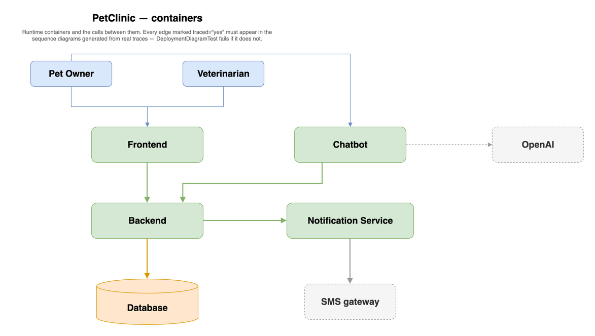
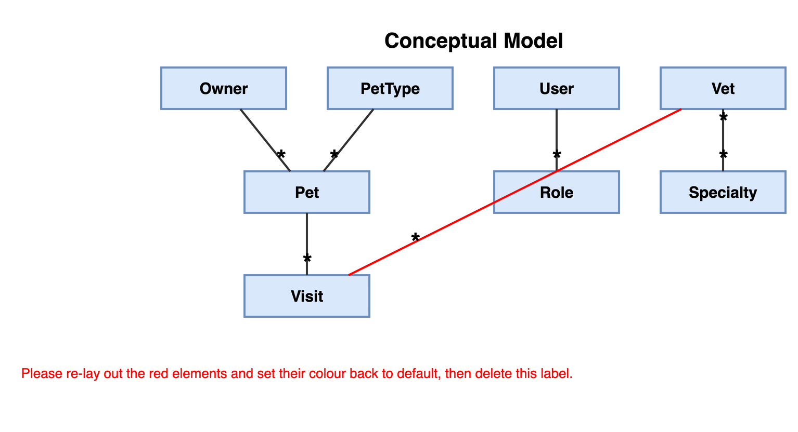

# PetClinic — an Agentic Engineering Playground

A full-stack PetClinic (Angular SPA + Spring Boot REST API). **The domain is
incidental** — this repo exists to demonstrate AI-assisted / agentic software
engineering techniques you can lift into your own projects.

## What this repo teaches

- **Living kept in sync architecture, kept honest by guardrail tests.** Diagrams and specs
  are *generated from the code*; ArchUnit + extractor tests fail the build when
  code and diagram drift apart. See [GUARDRAILS.md](GUARDRAILS.md).
- **Snapshot now, diff at review.** Committed diagrams stay a clean picture of
  *current* reality; the red add/remove delta is computed on demand from two git
  snapshots (`puml-diff`), when a human asks for it — see
  [`/human-review`](https://github.com/victorrentea/human-review).
- **Diagrams generated from code, rendered from source.** `.puml` files are
  committed and rendered live via the PlantUML proxy straight off GitHub raw —
  no build step to view them; each render carries a `footer` naming its own
  source (see [Architecture diagrams](#architecture-diagrams)).
- **C4 model** as versioned Structurizr DSL: stable, human C1/C2 + a
  *code-coupled* C3 that is unit-tested against the real packages.
- **E2E traces → sequence diagrams.** Tempo/OpenTelemetry spans from a browser
  run are replayed into a PlantUML sequence diagram.
- **MCP server** hosted by the backend at `/mcp` (Spring AI) — tools/resources
  an agent can call.
- **Code-first OpenAPI.** The spec is *extracted* from the controllers
  (`OpenApiExtractorTest` → `openapi.yaml`); the frontend's TS types are
  regenerated from it. Both drift-checked.
- **Hooks + CI backstop + CODEOWNERS.** Guardrail hooks run before every push,
  mirrored as unavoidable CI gates (blocking `--no-verify`), and compare
  *regenerated content* — not file paths — so they can't be gamed; sensitive
  files need elder review.
- **Observability.** Zero-code OpenTelemetry → Grafana LGTM, queryable from
  Claude Code via `mcp-grafana`.

For example, this domain class diagram is generated from the code by
`DomainModelExtractorTest` and rendered live from the committed
[`DomainModel.puml`](petclinic-backend/docs/generated/DomainModel.puml) — see
[Architecture diagrams](#architecture-diagrams) for the rest:


## Quickstart

A) Tell your agent: `start db,be,fe,grafana`

B) Manual: Run in separate terminals:
```sh
./start-database.sh   # ⇒ embedded Postgres        :5432
./start-backend.sh    # ⇒ Spring Boot (+OTel, MCP)  :8080
./start-frontend.sh   # ⇒ Angular dev server        :4200
./start-grafana.sh   # ⇒ :3300 (Requires Docker)
```
No Docker? `./start-tempo.sh` instead of `./start-grafana.sh` — Tempo alone (one downloaded
binary, :3200 + OTLP :4318): no dashboards, but everything the sequence diagrams need.

- App UI: http://localhost:4200 
- Backend Swagger: http://localhost:8080/swagger-ui.html

## Prompts to try

Tell an agent running in this repo:

### Agent Tasks

- **Trim boilerplate from .md** — remove from AGENTS.md the mvn/npm instructions any LLM already knows.
- **AGENTS.md: Fix drift** — check it is non-contradictory and in sync with project modules.
- **Scope rules by folder** — extract backend rules into a nested `petclinic-backend/AGENTS.md` that loads only there.
- **Prevent .md drift** — replace AGENTS.md's `## API Endpoints` with a pointer to the in-sync `openapi.yaml`.
- **AGENTS.md: Reference drift-safe knowledge** — replace the list of REST Endpoints in AGENTS.md with a link to the in-sync `openapi.yaml`.
- **Create a skill** — move `### Java Code Style` from AGENTS.md into a `java-code-style/SKILL.md`. Test it activates ±eval on 3 runs.
- **Turn skill into rule**: Turn the Java Code Style skill you extracted into a .claude/rules/java-rule.md that is loaded 100% before any .java file is edited.
- **Hooks** – create a hook that plays a sound when the agent finished its turn or waits for your answer/approval.
- **Scripted guardrail** – remove the rule about < 120 chars and try to manually violate it

### Petclinic Tasks

The tasks below have the pattern: **<description>** – <prompt to paste to agent>

- **⭐BE+FE feature** – Improve the owner search ([Issue #24](https://github.com/victorrentea/petclinic/issues/24)), then optionally review the code
- **Fix BE+FE bug** – Fix missing visit date validation ([Issue #40](https://github.com/victorrentea/petclinic/issues/40)): reproduce it in a browser, write a failing Playwright e2e test, then fix the bug so the test passes
- **Fix UI layout** – align the labels and values in the [owner details screen](http://localhost:4200/petclinic/owners/1) via Playwright screenshots
- **Regenerate the [user manual](user-manual/manual.md)** — `/regen-user-manual`
- **Latency study** — break down the time budget of a "search owners" click from recorded Grafana traces - where is most time lost?
- **SQL** — export an Excel pie chart of the pet types querying `postgres-db`, and open it when ready.
- **Query tuning** — optimize the "search owners by last name" flow.
- **Tuning tests** — speedup the backend tests (takes lots of time & tokens).
- **Exploratory QA** — download the [Playwright test agents](https://playwright.dev/docs/test-agents) and explore the app to write 10 significant automated .feature e2e tests
- **Grafana dashboard** — create a dashboard of what to monitor, then open it (start Grafana's Docker if needed).
  
Some tasks above require tools from the project's `.mcp.json`, which should autoload when you start the agent in this folder.

### Tools
Start YOUR agent in YOUR🫵 work project and tell it:

"Help me grant you access to:..."
- **Issues** — fetch the issues assigned to me on this git repo, put a test comment on the last one
- **CI** — find out how much time the tests took in the last CI run 
- **Logs** — get the last errors from the dev environment log
- **Browser** – reproduce a recent FE bug in a browser
- **DB** - which database tables have the most rows in my dev DB?
- **Metrics** - What is the endpoint with the highest latency in Grafana?
- **Token Saving** - Configure me headroom or at least RTK to save tokens.

Patiently guide the agent through this setup, then tell it: Turn the lessons you learned into a reusable skill, ideally scripting as much work you can. 

### Tools for Agentic Lifestyle
- [WisprFlow](https://wisprflow.ai) to dictate.
- [CodexBar](https://codexbar.app) and/or [AgentsView](https://www.agentsview.io/) to monitor the remaining Claude/Codex/Copilot quota/usage.
- [ScreenBrush](https://apps.apple.com/us/app/screenbrush/id1233965871) to draw on screen before a screenshot to agent. 
- [WalkieTalkie](https://github.com/victorrentea/walkie-talkie) to speak and point/crop/move/select/copy/record.
- [Victor's status line](https://github.com/victorrentea/victor-statusline) for Claude Code and Copilot CLI: per-turn cost, quota burn-rate, prompt-cache health, suspend until quota refills
- [Human Review](https://github.com/victorrentea/human-review) - helper suite to review AI-gen PRs effectively

### Ideas to adopt into your own project ❤️

Start an agent in **your** project and prompt it: 
From the https://github.com/victorrentea/petclinic repo adopt…
- `packages.puml` kept in sync with code structure via tests.
- `DomainModel.puml` generated from code via reflection.
- `ConceptualModel.drawio.png` unit-tested vs code using reflection.
- `DB.puml` built from from the incremental DB scripts.
- In-sync Backend Java REST API <=> `openapi.yaml` <=> frontend `api-types.ts`.
- Agent auto-fixes the CI after any push.
- Running critical tests before every push (githooks/) and again in CI (workflows/).
- CODEOWNERS file to protect critical files behind tech-lead/architect review to prevent dev fatigue-LGTM.
- Gherkin .feature tests - write 3 for the most critical flows of my app
- Generate sequence diagrams from selected e2e tests, as in `petclinic-test/generated/*.genseq.puml`.
- assemble a reviewer's guide for a change set — as in https://github.com/victorrentea/human-review

## Architecture diagrams

Every diagram is **generated from the code** and rendered live via the
[PlantUML proxy](https://plantuml.com/) off the GitHub-hosted `.puml` source —
each carries a `footer` with its own repo path, so the render is self-identifying.

The two `.drawio.png` diagrams are the exception: drawn by hand, but not therefore
unchecked — the mxGraph XML rides inside the picture, and a guardrail test reads it back
and compares it against the code.

### Deployment (FE → BE → DB)


> Hand-drawn, and it has to be: the backend cannot
> introspect the Angular SPA or PostgreSQL. It stays honest anyway — it is a `.drawio.png`,
> so the mxGraph XML rides inside the picture (open it in the draw.io desktop app and edit
> it in place), and every box and arrow carries metadata that `DeploymentDiagramTest`
> checks against the sequence diagrams generated from real traces.

### Domain model


### Conceptual model (hand-arranged)


> The same concepts and links as above, but laid out by people and staying where they were
> put — which is the whole point, since PlantUML re-arranges its own diagram on every
> regeneration and resets everyone's spatial memory of it. `ConceptualModelDiagramTest` owns
> the content (every box, line and cardinality must match the domain classes) and never the
> positions; a new concept is parked in the staging lane on the left by
> `docs/scripts/conceptual-model-patch.py` and keeps the build red until a human places it.

### Database (ER)


### Packages (logical architecture)


### E2E sequence (from real traces)


### C4 — System Context


> More C4 views (containers, per-component focus) live in
> [`petclinic-backend/docs/README.md`](petclinic-backend/docs/README.md).
