# PetClinic User Manual

PetClinic is a small veterinary practice management application. You can use it to keep records of pet owners, the pets in their care, the veterinarians on staff, the specialties those vets practice, and the visits the pets make to the clinic.

_This file is regenerated by the `/regen-user-manual` slash command. Do not edit by hand — your changes will be overwritten on the next regeneration._

## Contents

- [Getting around](#getting-around)
- [Welcome](#welcome)
- [Owners](#owners)
- [Pets](#pets)
- [Visits](#visits)
- [Pet Types](#pet-types)
- [Veterinarians](#veterinarians)
- [Specialties](#specialties)

---

## Getting around

The dark bar at the top of every screen is your main menu. *Home*, *Owners*, *Visits*, *Pet Types* and *Specialties* are plain links that take you straight to that screen. *Veterinarians* is a drop-down menu: click it to choose between *All* (the list of vets) and *Add New* (the form for a new vet). The dog icon on the far left also takes you back to the start.

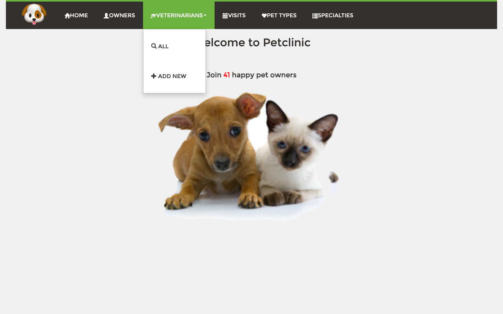

The screenshot above shows the *Veterinarians* menu opened, with its two choices.

---

## Welcome

The welcome screen is what you see when you first open PetClinic. It greets you and tells you how many pet owners the clinic has on record. There is nothing to do here — use the menu bar to go where you need.

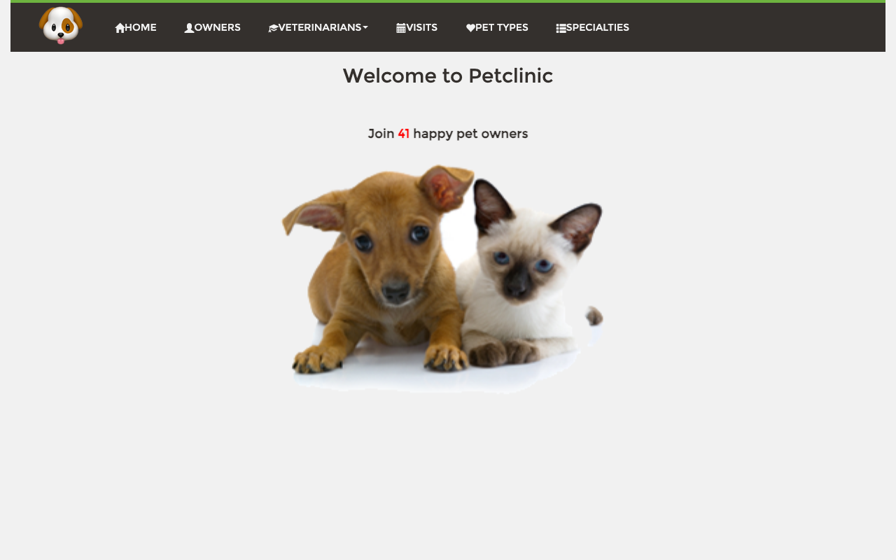

---

## Owners

The Owners area is the heart of the clinic's records. Every pet belongs to an owner, so this is where you register new clients, look them up, and correct their details. An owner's record is also where you add their pets and book visits — see [Pets](#pets) and [Visits](#visits).

### Viewing the list

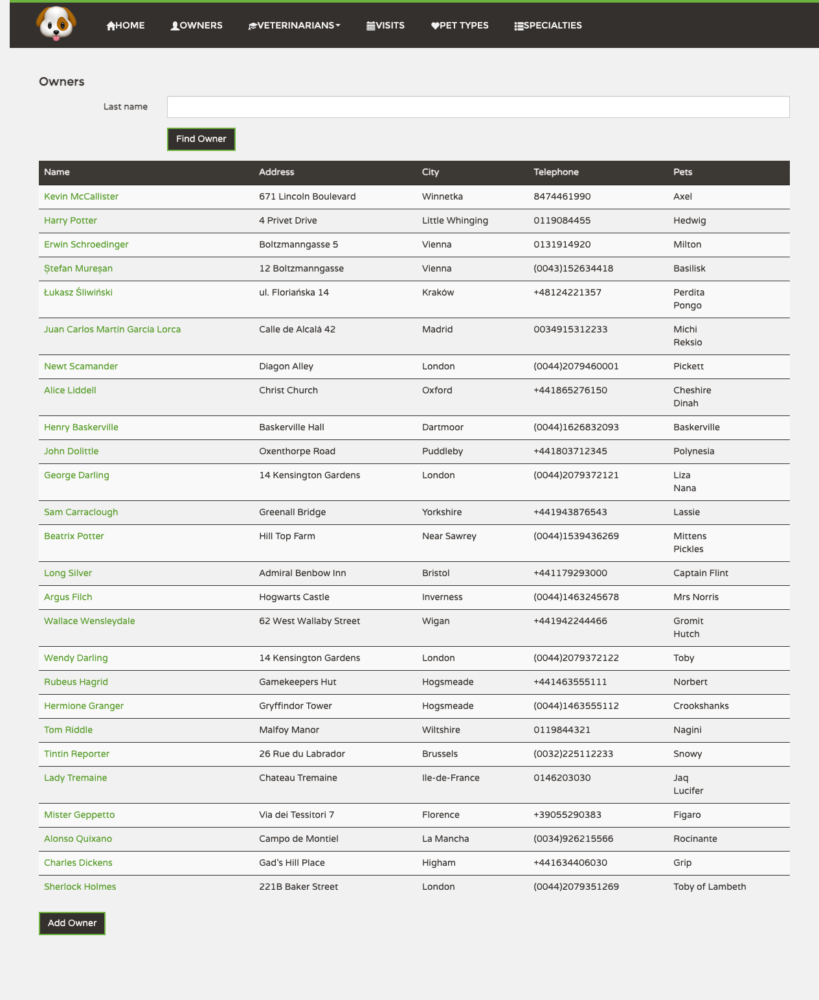

1. Click *Owners* in the menu bar.
2. The table lists every owner with their address, city, telephone and the names of their pets.
3. Click an owner's name to open their record.

### Finding an owner

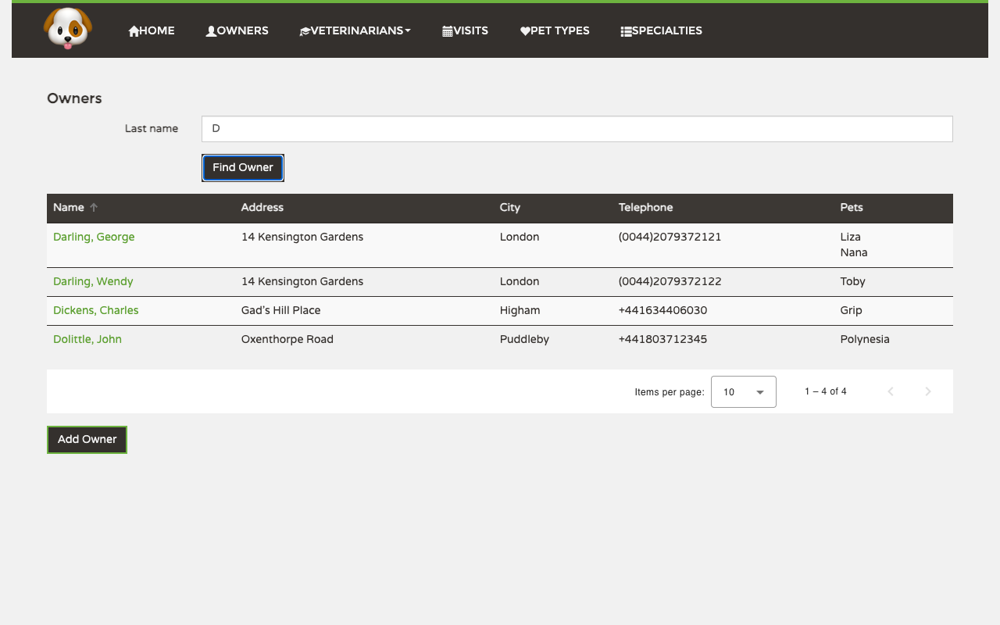

1. Type the beginning of the owner's last name in the *Last name* box — "Pot" finds both Potters.
2. Click *Find Owner*. The table now shows only the matching owners.
3. To see everyone again, empty the box and click *Find Owner* once more.

### Creating a new owner

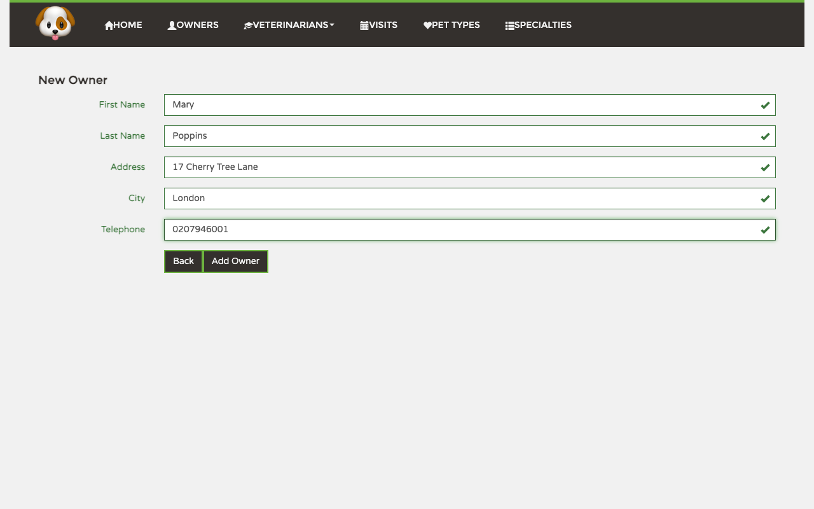

1. On the owners list, click *Add Owner* below the table.
2. Fill in *First Name*, *Last Name*, *Address*, *City* and *Telephone*. Every field is required; a green tick appears next to each one you have filled correctly.
3. The *Add Owner* button stays greyed out until the form is complete. Click it to save — you return to the owners list, where the new owner now appears.
4. Click *Back* to leave without saving.

### Looking at an owner's record

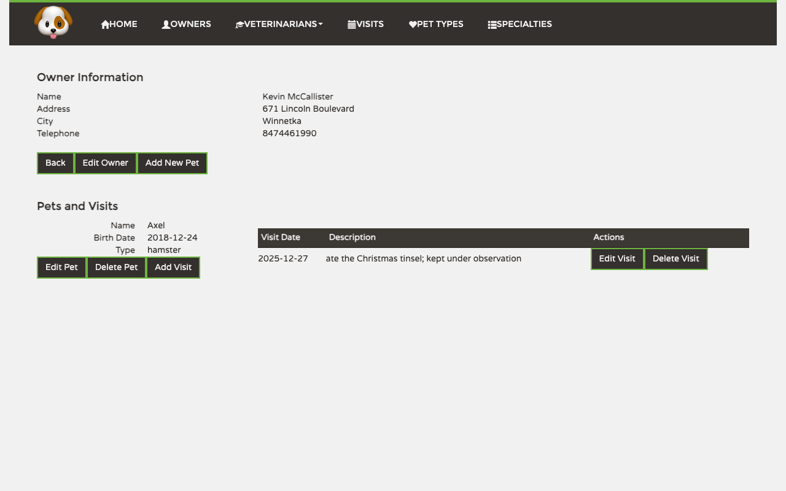

1. Click an owner's name in the list.
2. The top half shows the owner's contact details. Three buttons sit under them:
   - *Back* returns to the owners list.
   - *Edit Owner* opens the form to correct the details.
   - *Add New Pet* registers a new pet for this owner — see [Pets](#pets).
3. Under *Pets and Visits*, each pet is shown with its birth date and type, and next to it the visits it has had. From here you can edit or delete the pet, add a visit, and edit or delete each visit.

> Deleting a pet or a visit happens immediately, with no "are you sure?" question. Make sure you click the right row.

### Editing an owner

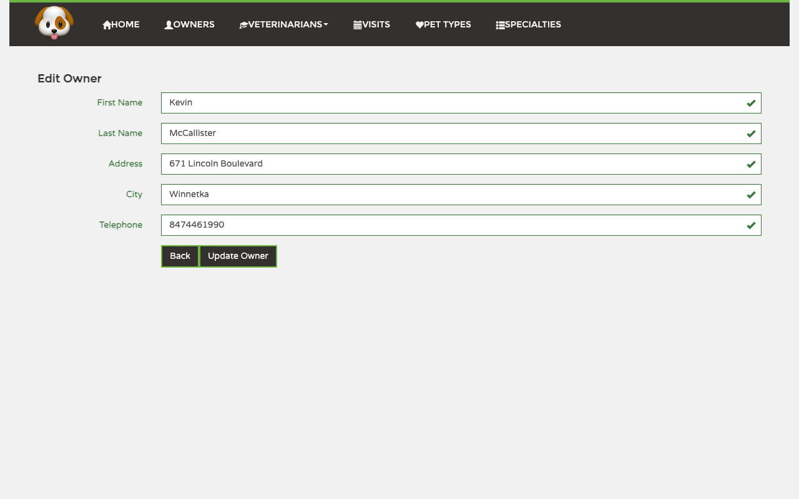

1. On the owner's record, click *Edit Owner*.
2. The form opens already filled in with the current details. Change what you need.
3. Click *Update Owner* to save; you return to the owner's record. Click *Back* to discard your changes.

---

## Pets

Pets are always managed from their owner's record — find the owner first (see [Owners](#owners)), then add or change their pets there.

### Adding a pet

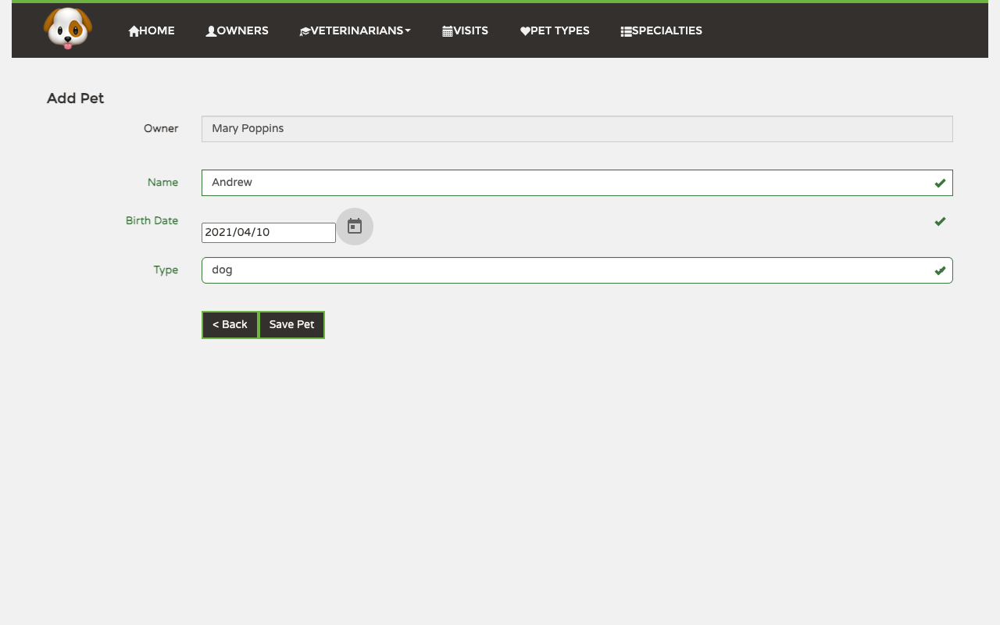

1. On the owner's record, click *Add New Pet*.
2. The owner's name is filled in for you and cannot be changed.
3. Type the pet's *Name*.
4. Enter the *Birth Date* as year/month/day (for example 2024/03/15), or click the calendar icon and pick the day.
5. Choose the *Type* (cat, dog, hamster, and so on). The list comes from [Pet Types](#pet-types).
6. Click *Save Pet*. You return to the owner's record, where the new pet is listed. *< Back* leaves without saving.

### Editing a pet

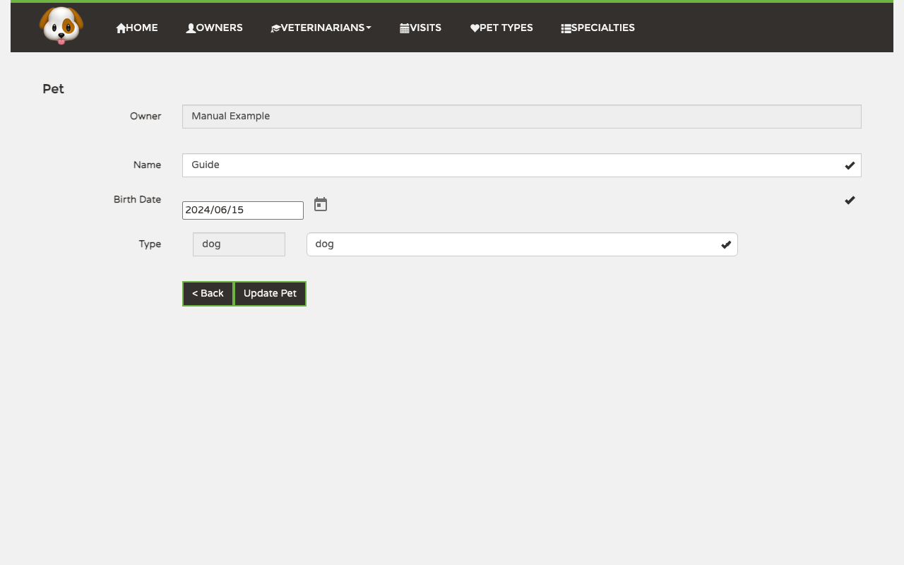

1. On the owner's record, click *Edit Pet* next to the pet.
2. The form opens filled in with the pet's name, birth date and type. Change what you need.
3. Click *Update Pet* to save and return to the owner's record, or *< Back* to discard your changes.

---

## Visits

A visit records when a pet came to the clinic and why. You book a visit from the owner's record (see [Owners](#owners)); the *Visits* screen lists every visit across the clinic.

### Viewing the list

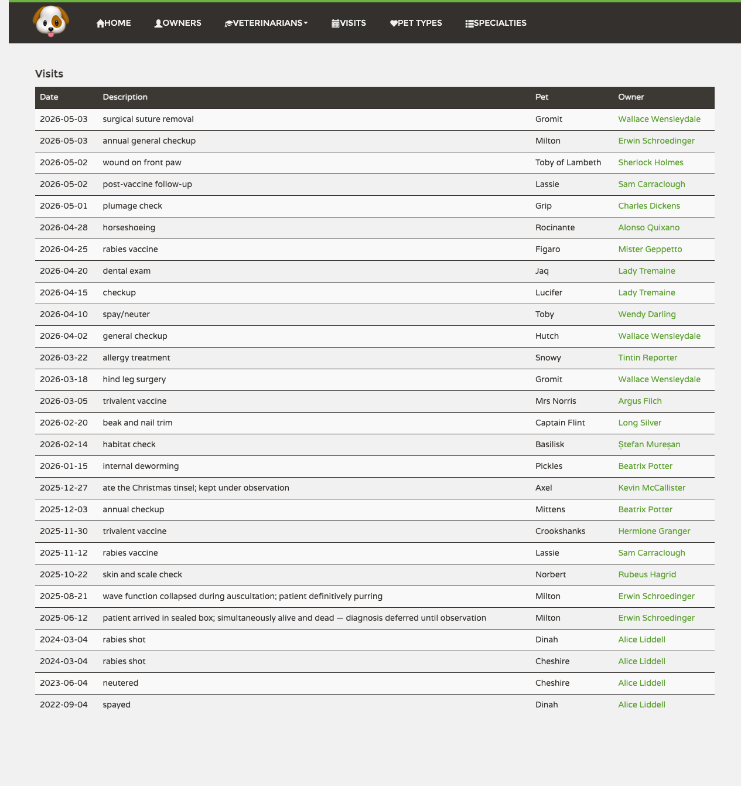

1. Click *Visits* in the menu bar.
2. The table shows every visit, most recent first, with the date, the reason, the pet and its owner.
3. Click the owner's name to open their record.

### Booking a visit

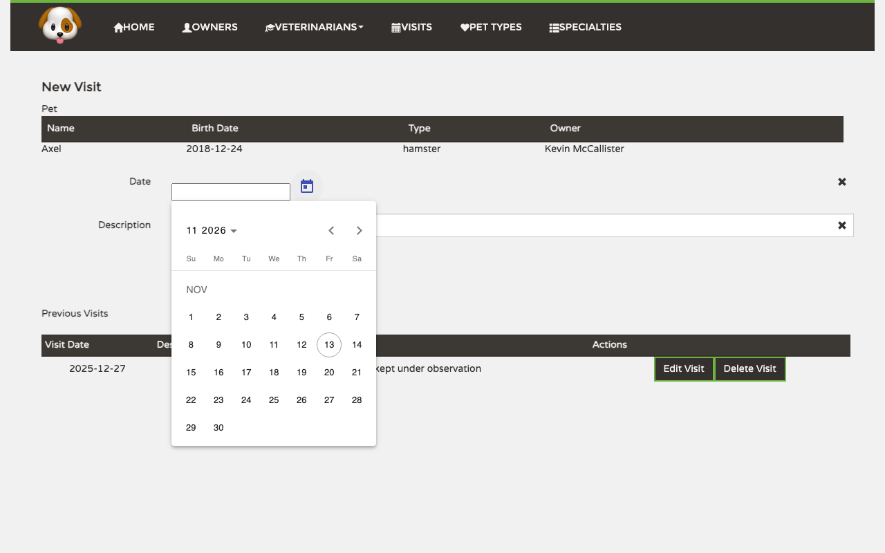

1. On the owner's record, click *Add Visit* next to the pet.
2. The top of the form confirms which pet the visit is for, with its birth date, type and owner.
3. Click the calendar icon next to *Date* and pick the day, as shown above. You can only pick a day between the pet's birth date and one year from today; the other days are greyed out.

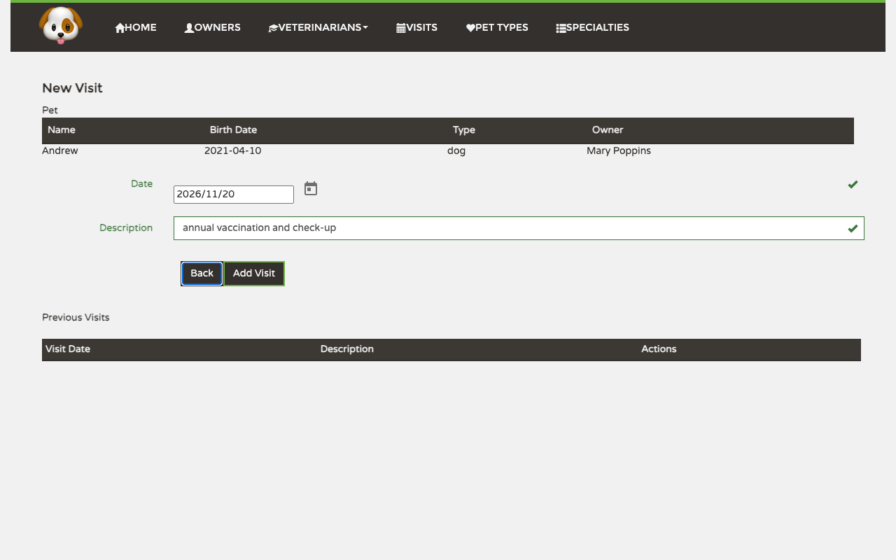

4. Type the reason for the visit in *Description*.
5. Click *Add Visit*. You return to the owner's record, where the visit appears next to the pet. *Back* leaves without saving.
6. The pet's earlier visits are listed under *Previous Visits*, so you can check its history while you book.

If you type a date by hand that falls outside the allowed range, a message under the field explains why and *Add Visit* stays greyed out.

### Editing a visit

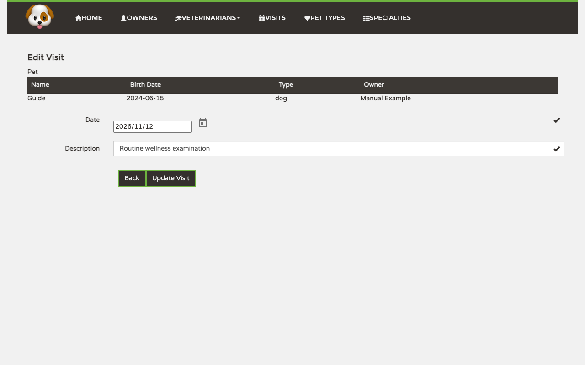

1. On the owner's record, click *Edit Visit* next to the visit.
2. The form opens with the visit's current date and description. Change what you need — the same date range applies as when booking.
3. Click *Update Visit* to save and return to the owner's record, or *Back* to discard your changes.

---

## Pet Types

Pet types are the choices offered in the *Type* list when you add or edit a pet (see [Pets](#pets)). You rarely need to change them — only when the clinic starts treating a new kind of animal.

### Viewing the list

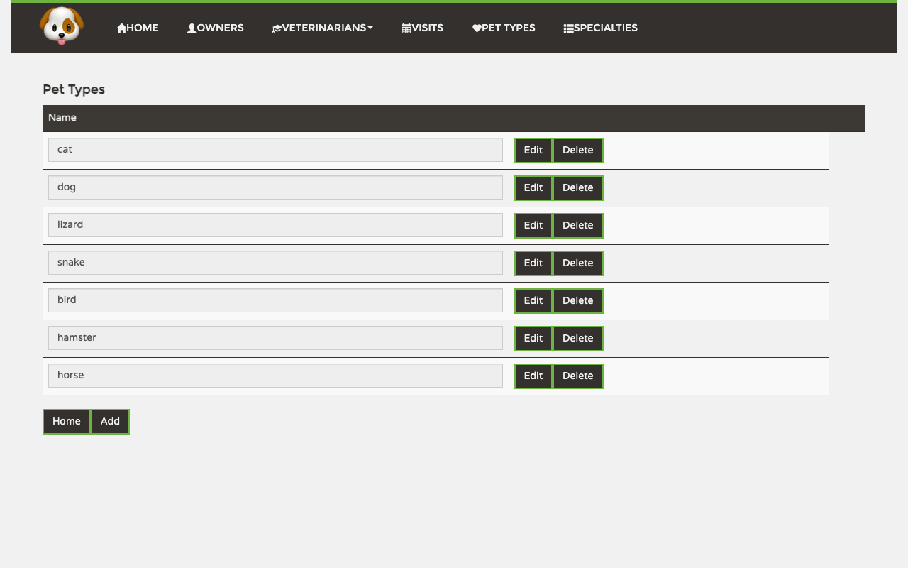

1. Click *Pet Types* in the menu bar.
2. Each type is listed with an *Edit* and a *Delete* button. *Delete* removes the type immediately, without asking for confirmation.
3. *Home* takes you back to the welcome screen.

### Adding a pet type

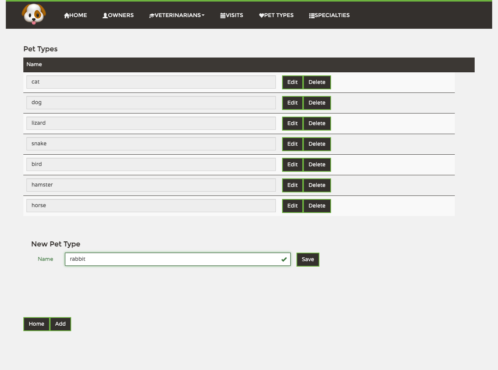

1. On the pet types list, click *Add* at the bottom.
2. A *New Pet Type* box appears under the list. Type the name.
3. Click *Save*. The new type is added to the list and becomes available when you add a pet.

### Editing a pet type

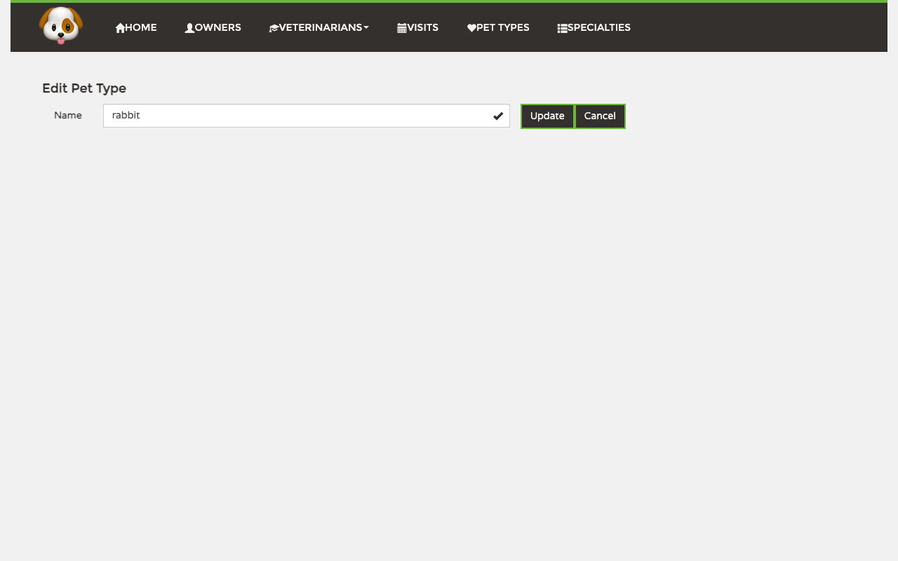

1. Click *Edit* next to the type.
2. Change the name.
3. Click *Update* to save and return to the list, or *Cancel* to discard your change.

---

## Veterinarians

This area lists the clinic's vets and the specialties each one practices. Reach it through the *Veterinarians* drop-down in the menu bar (see [Getting around](#getting-around)). The specialties themselves are managed under [Specialties](#specialties).

### Viewing the list

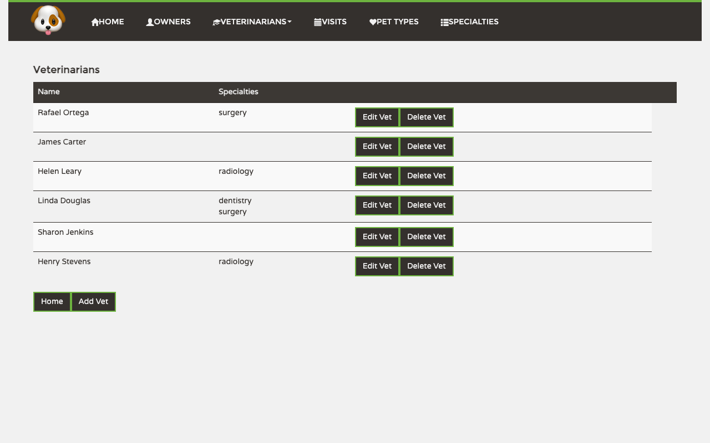

1. Click *Veterinarians*, then *All*.
2. Each vet is listed with their specialties, if they have any.
3. *Edit Vet* opens the vet's details; *Delete Vet* removes the vet immediately, without asking for confirmation.
4. *Add Vet* below the list opens the form for a new vet; *Home* goes back to the welcome screen.

### Adding a vet

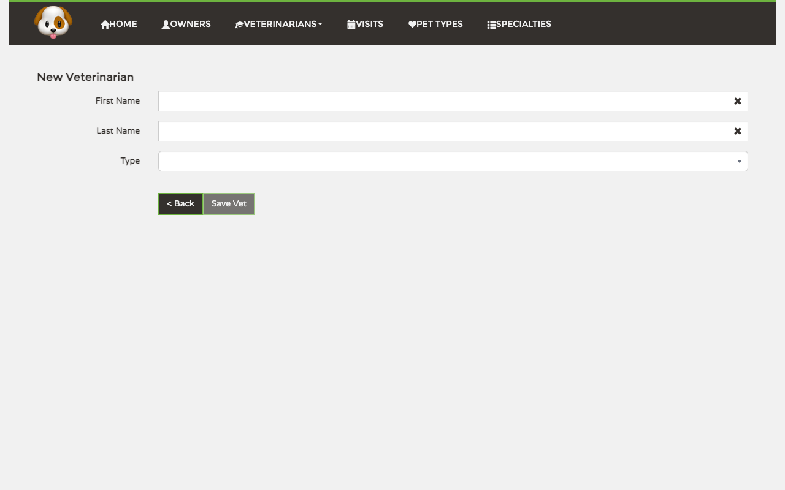

1. Click *Veterinarians*, then *Add New* — or click *Add Vet* below the list.
2. Fill in *First Name* and *Last Name*.
3. Pick the vet's specialty from the *Type* list.
4. Click *Save Vet*. You return to the list of vets. *< Back* leaves without saving.

### Editing a vet

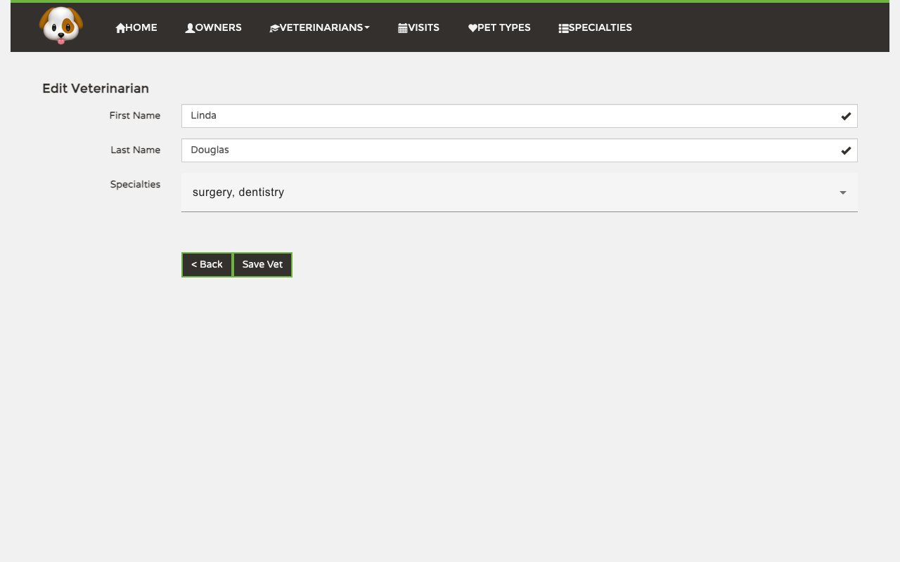

1. On the list of vets, click *Edit Vet* next to the vet.
2. The form opens with the vet's name and current specialties.

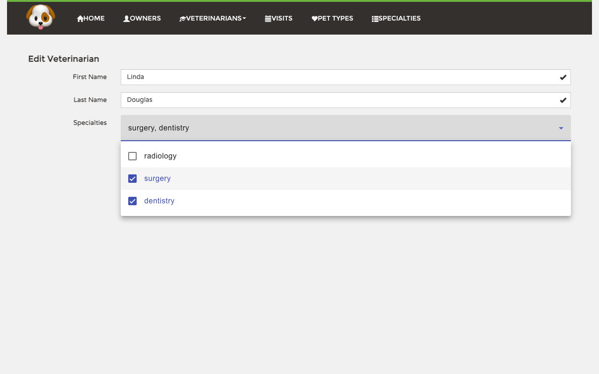

3. Click the *Specialties* box to open the list, and tick or untick each specialty — a vet can have several, or none.
4. Click *Save Vet* to save and return to the list, or *< Back* to discard your changes.

---

## Specialties

Specialties are the areas of medicine a vet can practice, such as radiology or surgery. You assign them to vets under [Veterinarians](#veterinarians).

### Viewing the list

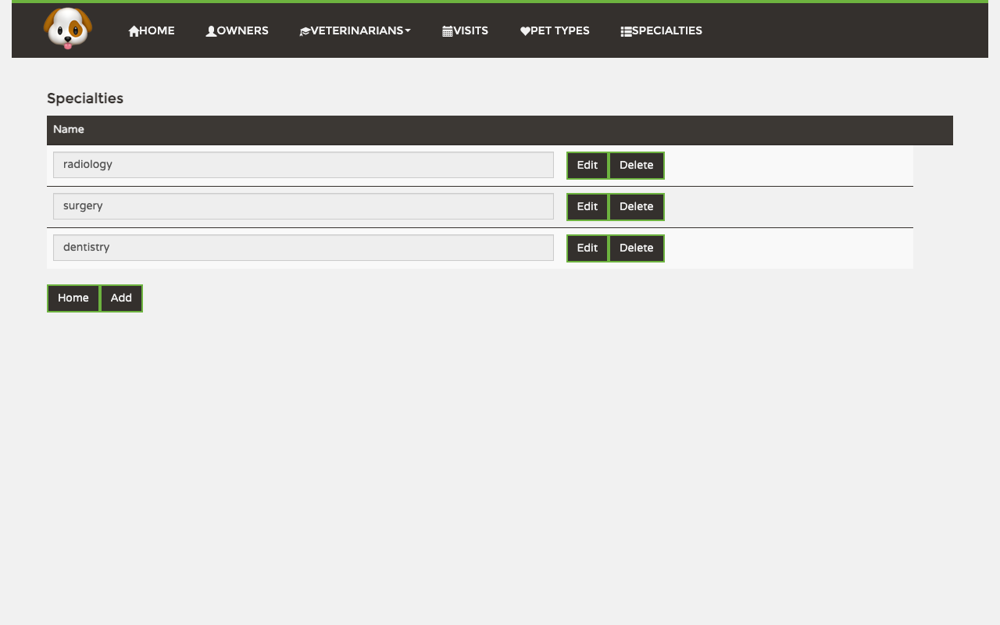

1. Click *Specialties* in the menu bar.
2. Each specialty is listed with an *Edit* and a *Delete* button. *Delete* removes the specialty immediately, without asking for confirmation.
3. *Home* takes you back to the welcome screen.

### Adding a specialty

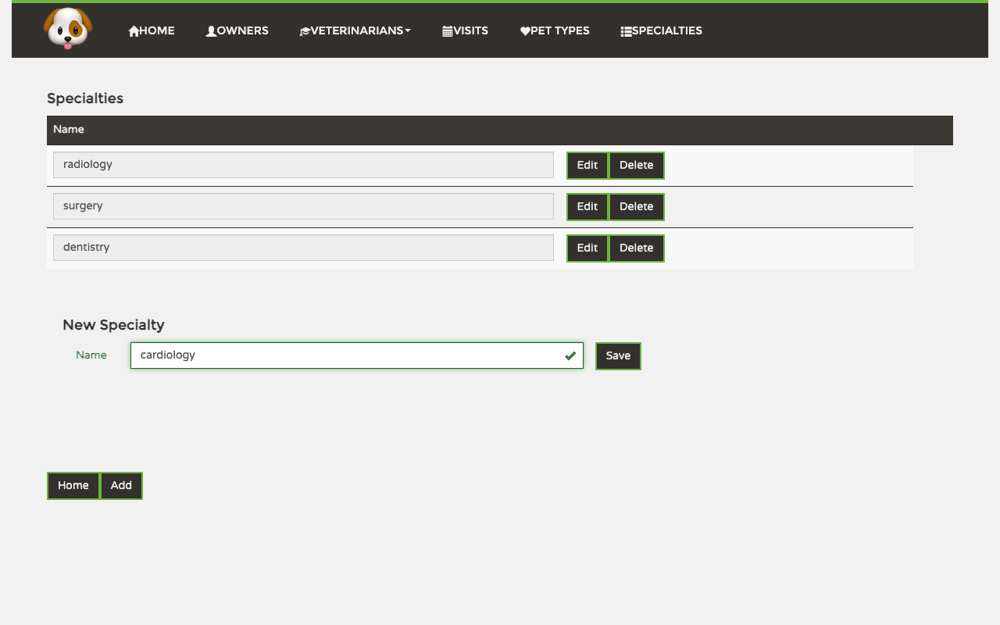

1. On the specialties list, click *Add* at the bottom.
2. A *New Specialty* box appears under the list. Type the name.
3. Click *Save*. The new specialty is added to the list and can now be given to vets.

### Editing a specialty

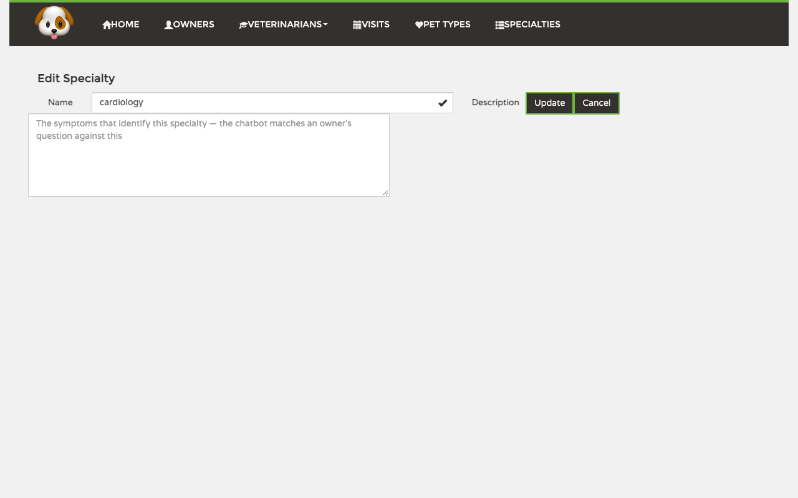

1. Click *Edit* next to the specialty.
2. Change the *Name* if needed.
3. In *Description*, list the symptoms that point to this specialty, separated by commas (for example "limping, broken bone, swollen leg"). These help match an owner's question to the right kind of vet.
4. Click *Update* to save and return to the list, or *Cancel* to discard your changes.
