# PetClinic User Manual

PetClinic is a small veterinary practice management application. You can use it to keep records of pet owners, the pets in their care, the veterinarians on staff, the specialties those vets practice, and the visits the pets make to the clinic.

_This file is regenerated by the `/regen-user-manual` slash command. Do not edit by hand — your changes will be overwritten on the next regeneration._

## Contents

- [Getting around](#getting-around)
- [Welcome](#welcome)
- [Owners](#owners)
- [Pets](#pets)
- [Visits](#visits)
- [Pet Types](#pet-types)
- [Veterinarians](#veterinarians)
- [Specialties](#specialties)

---

## Getting around

The dark bar across the top of every screen is your main menu. *Home*, *Owners*, *Visits*, *Pet Types* and *Specialties* are plain links that take you straight to that screen. *Veterinarians* is a dropdown menu: click it to choose between *All* (the list of vets) and *Add New* (the form for registering a new vet). Clicking the puppy logo on the left also brings you back to the start.

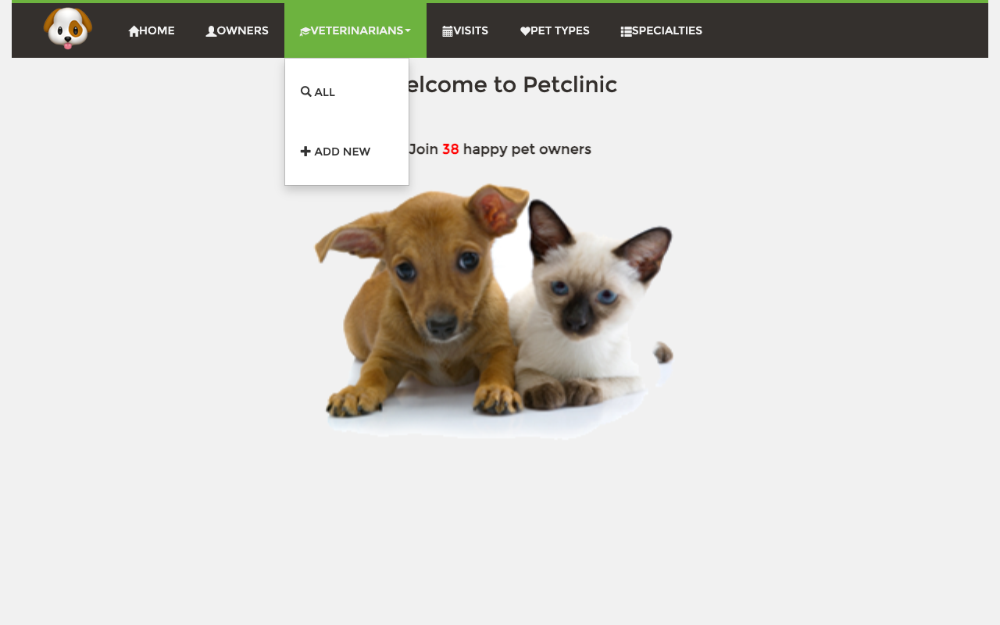

The screenshot shows the *Veterinarians* menu opened, with its *All* and *Add New* entries.

---

## Welcome

The Welcome screen is what you see when you open PetClinic or click *Home*. It greets you and shows how many pet owners the clinic currently has on file. There is nothing to do here — use the menu above to get to work.

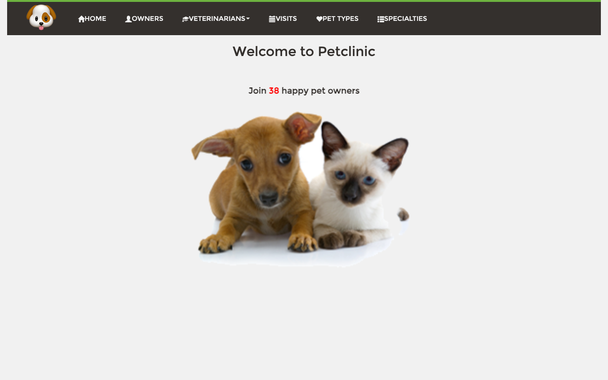

---

## Owners

The Owners area is where most daily work starts. Here you find a pet owner, register a new one, and correct their contact details. An owner's record is also the place where you add their pets and book visits for them — see [Pets](#pets) and [Visits](#visits).

### Viewing the list

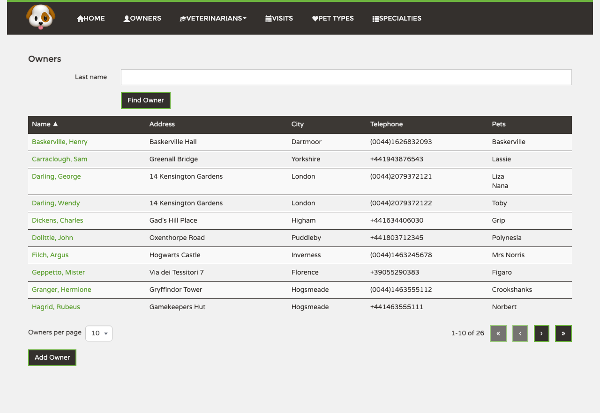

1. Click *Owners* in the top menu.
2. The table lists every owner with their name, address, city, telephone number and the names of their pets.
3. Click an owner's name to open their record.
4. The *Add Owner* button at the bottom of the list opens the form for a new owner.

### Finding an owner

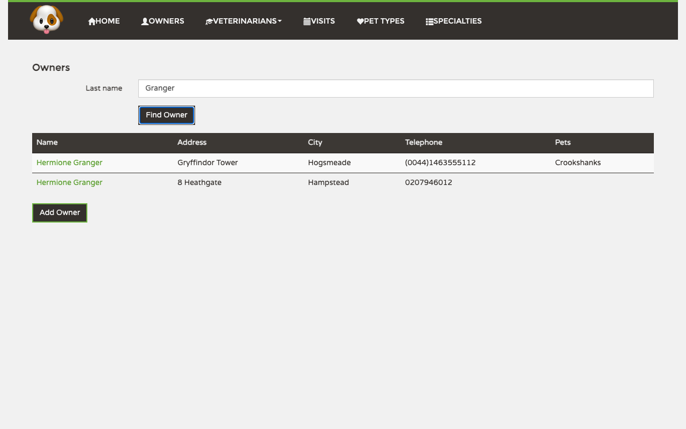

1. Type the owner's last name (or just its first few letters) into the *Last name* box above the table.
2. Click *Find Owner*. The table now shows only the matching owners.
3. To see everyone again, empty the box and click *Find Owner* once more.

### Creating a new owner

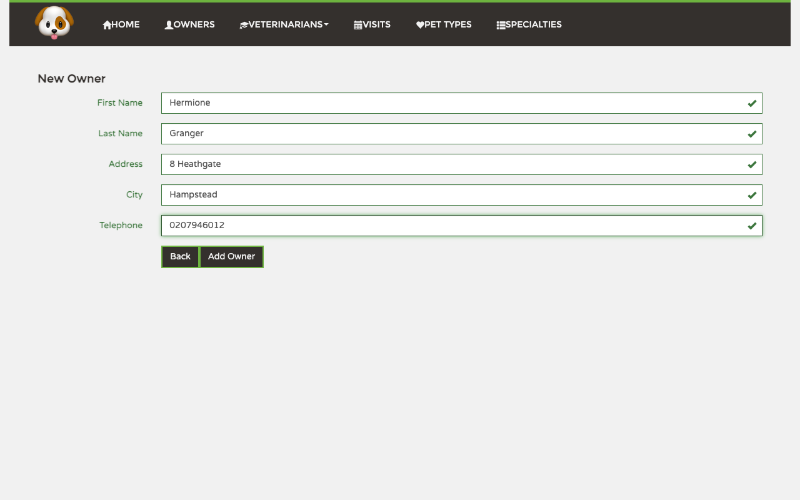

1. On the Owners list, click *Add Owner*.
2. Fill in *First Name*, *Last Name*, *Address*, *City* and *Telephone*. A tick appears next to every field that is filled in correctly.
3. The *Add Owner* button stays greyed out until all five fields are filled in. Click it to save.
4. You return to the Owners list, where the new owner now appears. Click *Back* instead if you change your mind.

### Looking at an owner's record

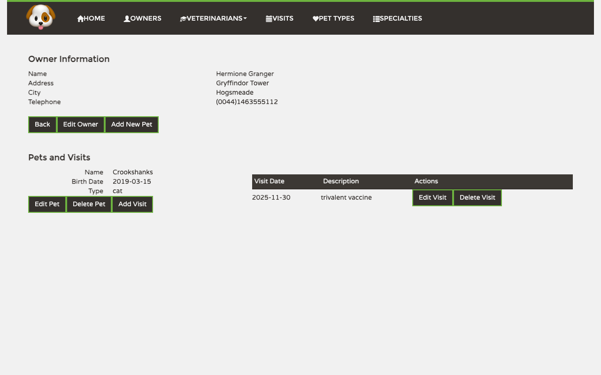

1. Click an owner's name on the Owners list.
2. The top table, *Owner Information*, shows the owner's name, address, city and telephone number.
3. Below it, *Pets and Visits* lists each of the owner's pets — name, birth date and type — next to the visits that pet has had.
4. Use the buttons to act on the record:
   - *Back* returns to the Owners list.
   - *Edit Owner* opens the owner's contact details for changes.
   - *Add New Pet* registers another pet for this owner (see [Pets](#pets)).
   - Under each pet, *Edit Pet*, *Delete Pet* and *Add Visit* act on that pet; next to each visit, *Edit Visit* and *Delete Visit* act on that visit.

### Editing an owner

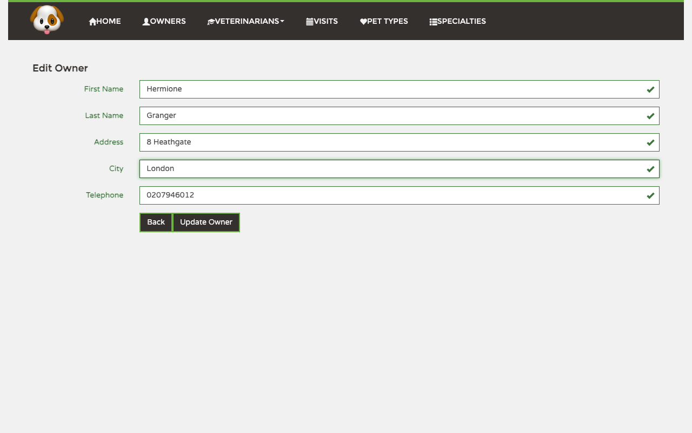

1. On the owner's record, click *Edit Owner*.
2. The form opens already filled in with the owner's current details. Change whatever needs correcting.
3. Click *Update Owner* to save; you land back on the owner's record. Click *Back* to leave without saving.

---

## Pets

Pets are always registered and changed from their owner's record — open the owner first (see [Owners](#owners)), then use the buttons in the *Pets and Visits* section.

### Adding a pet

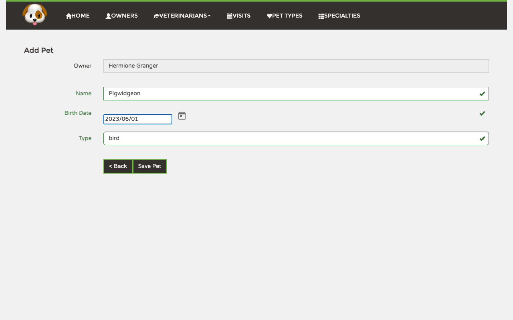

1. On the owner's record, click *Add New Pet*.
2. The *Owner* field is already filled in for you.
3. Enter the pet's *Name*, pick its *Birth Date* (type it or click the calendar icon), and choose its *Type* from the list (cat, dog, bird, ...).
4. Click *Save Pet*. The button stays greyed out until every field is filled in. Click *< Back* to leave without saving.

### Looking at a pet's record

1. After saving, you are taken back to the owner's record and the new pet appears under *Pets and Visits*.
2. Each pet shows its name, birth date and type, with its visits listed to the right.
3. *Delete Pet* removes the pet from the owner's record.

### Editing a pet

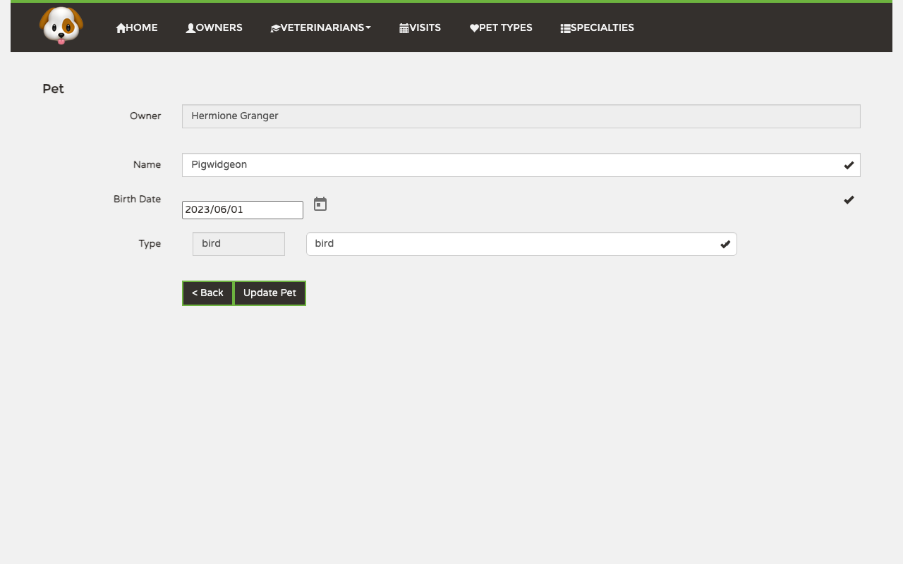

1. On the owner's record, click *Edit Pet* under the pet you want to change.
2. The form opens with the pet's current name, birth date and type.
3. Make your changes and click *Update Pet* to save, or *< Back* to leave without saving.

---

## Visits

A visit records that a pet came to the clinic, on which date, and why. You book a visit from the pet's owner's record (see [Owners](#owners)); the *Visits* screen in the top menu gives you an overview of every visit at the clinic.

### Viewing the list

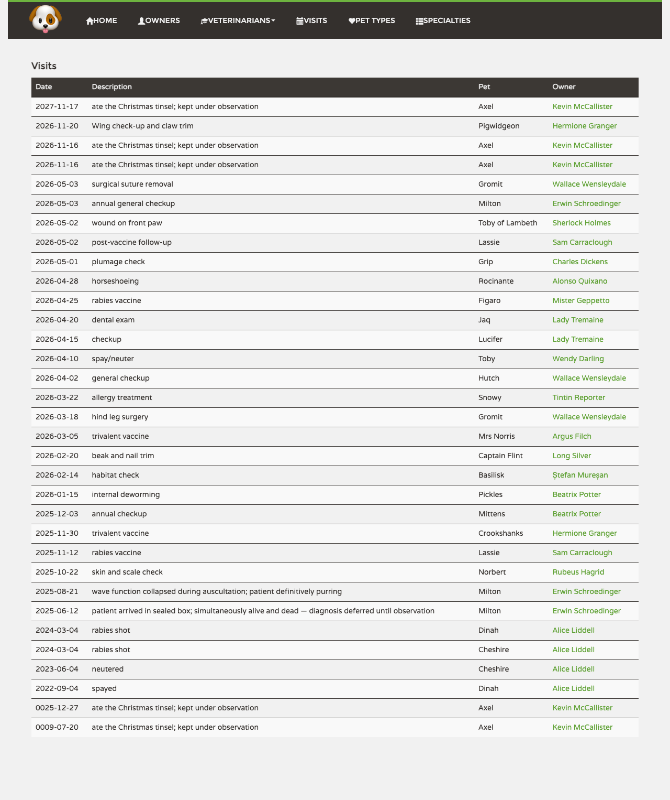

1. Click *Visits* in the top menu.
2. The table lists every visit, most recent date first, with the description, the pet, and the pet's owner.
3. Click an owner's name to jump to that owner's record.

### Adding a visit

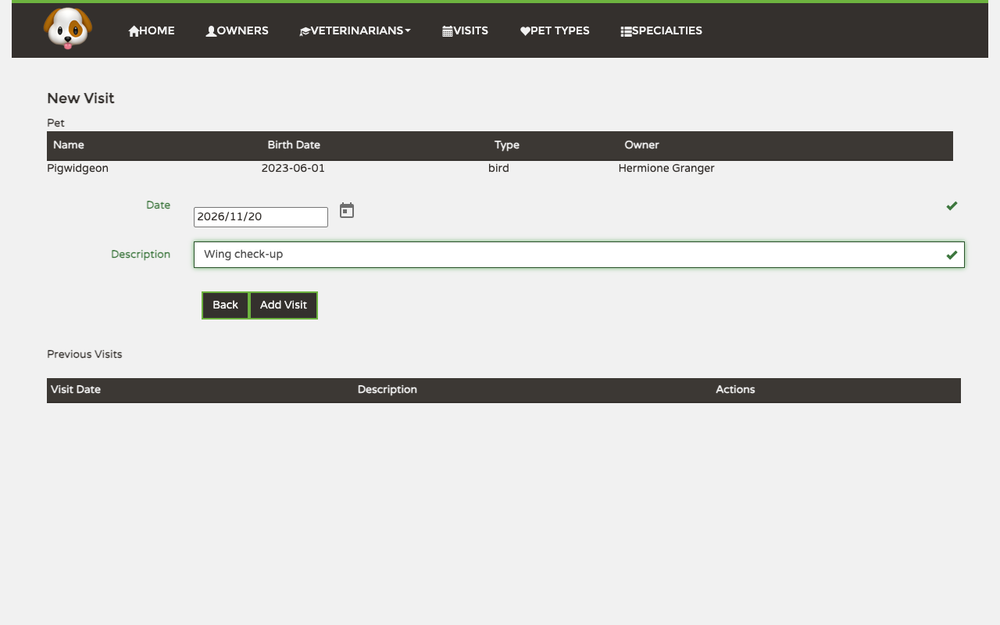

1. Open the owner's record and click *Add Visit* under the right pet.
2. The top of the screen confirms which pet you are booking for, with its birth date, type and owner.
3. Pick the *Date* (type it or use the calendar icon) and write a short *Description* of the reason for the visit.
4. Click *Add Visit* to save; you return to the owner's record, where the visit now appears next to the pet. Click *Back* to leave without saving.
5. Any earlier visits of this pet are listed under *Previous Visits* at the bottom of the screen.

### Editing a visit

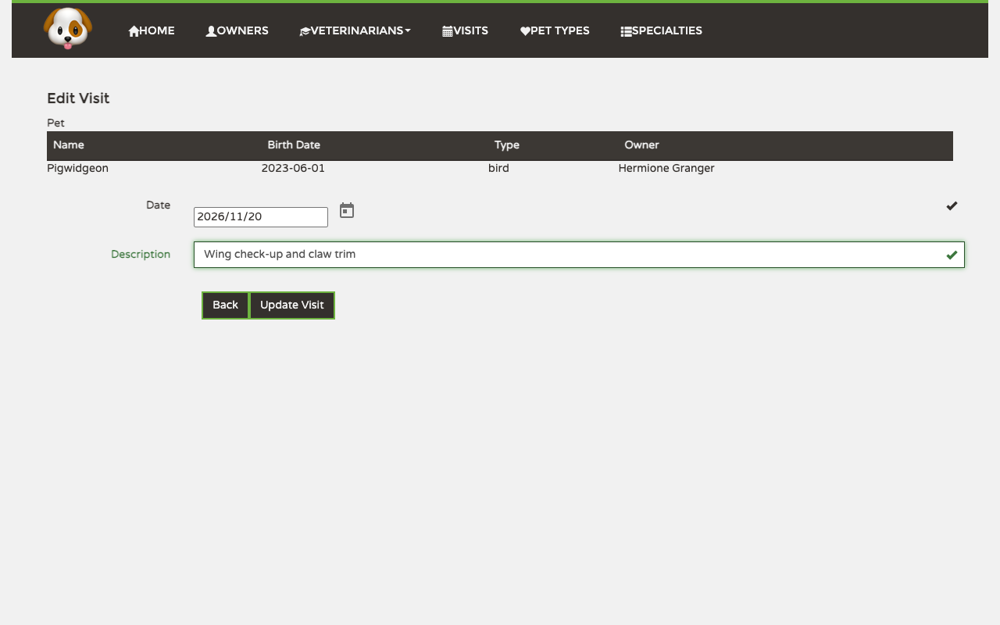

1. On the owner's record, click *Edit Visit* next to the visit you want to change.
2. The form opens with the visit's current date and description.
3. Make your changes and click *Update Visit* to save, or *Back* to leave without saving.
4. To cancel a visit altogether, click *Delete Visit* next to it on the owner's record.

---

## Pet Types

Pet types are the kinds of animal the clinic treats (cat, dog, bird, ...). They make up the *Type* list you choose from when adding or editing a pet.

### Viewing the list

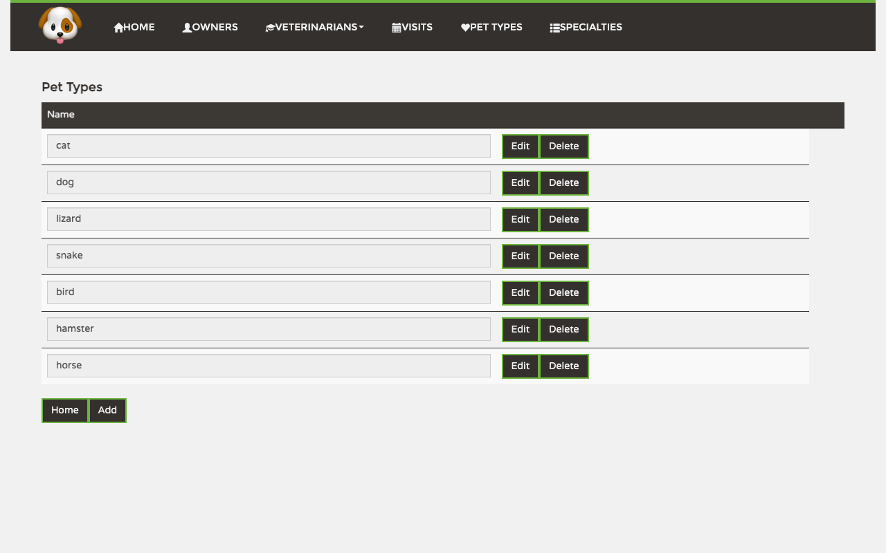

1. Click *Pet Types* in the top menu.
2. Every pet type is listed with an *Edit* and a *Delete* button next to it.
3. *Home* takes you back to the Welcome screen; *Add* opens the form for a new type.

### Creating a new pet type

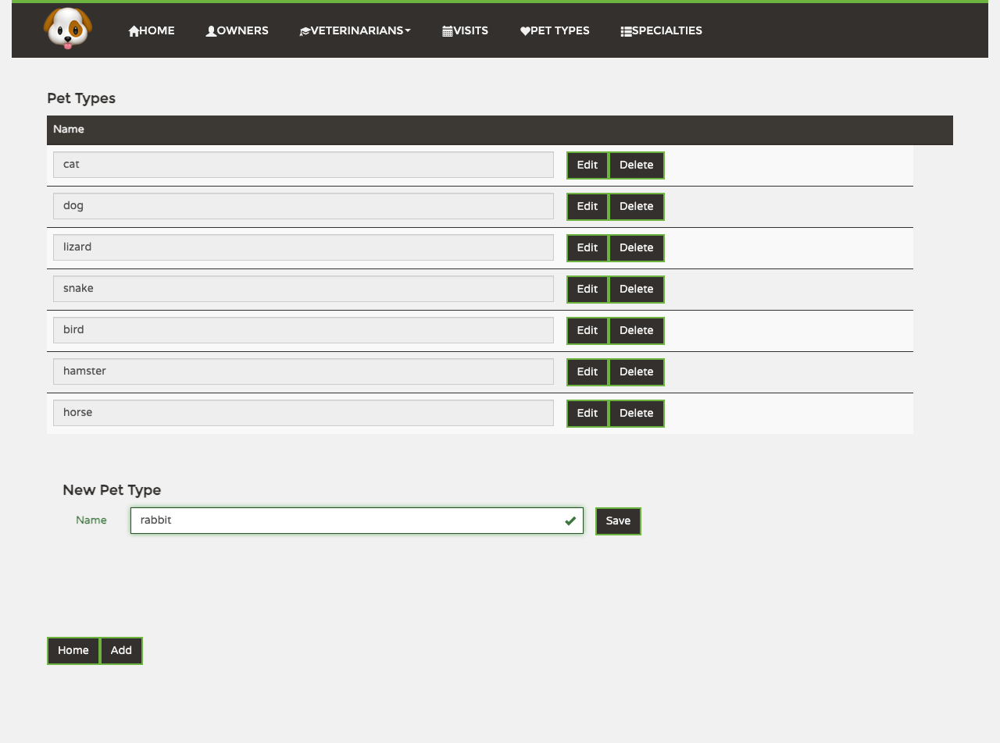

1. Click *Add* below the list. A *New Pet Type* form appears under the table.
2. Type the name of the new animal kind.
3. Click *Save*. The new type is added to the list and is immediately available when adding a pet.

### Editing a pet type

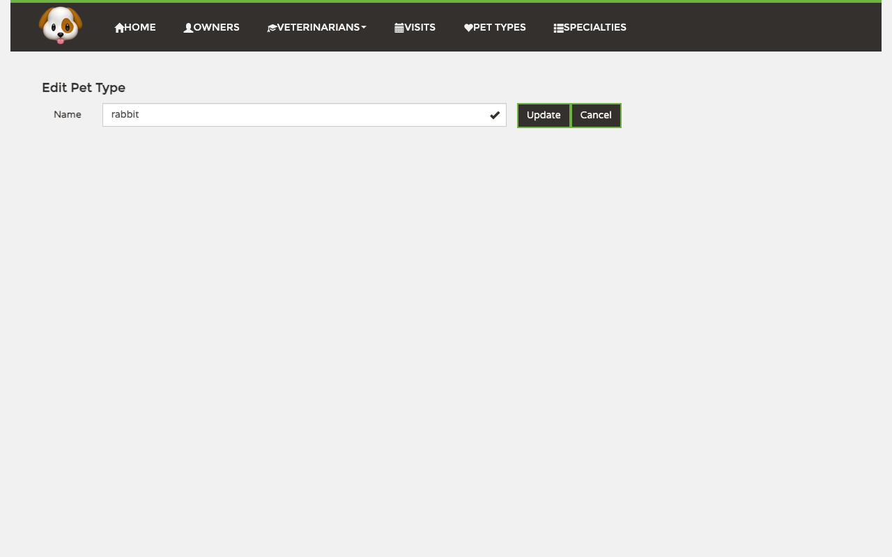

1. Click *Edit* next to the pet type you want to rename.
2. The *Edit Pet Type* form opens with the current name.
3. Change it and click *Update* to save, or *Cancel* to return to the list without changes.

---

## Veterinarians

This area holds the vets working at the clinic and the specialties each one practices.

### Viewing the list

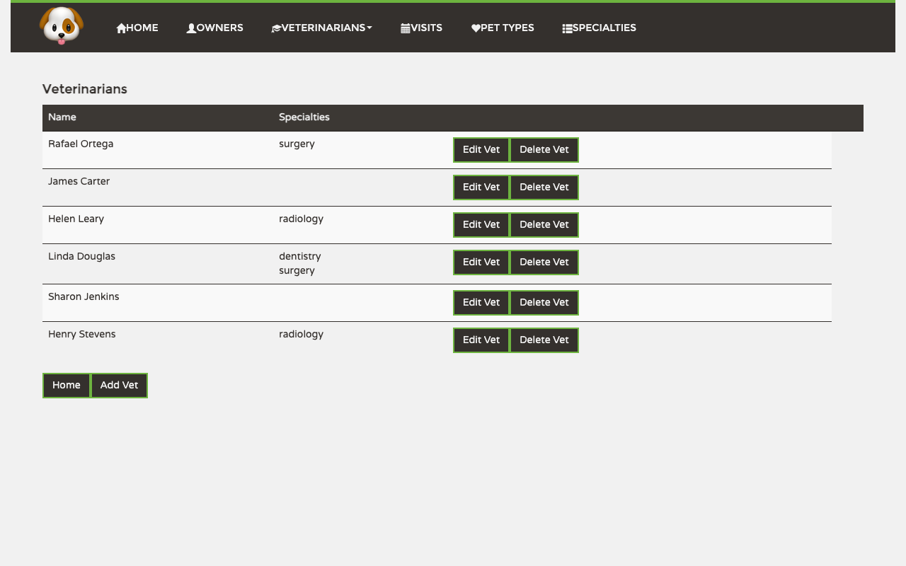

1. Open the *Veterinarians* menu and choose *All*.
2. The table lists every vet by name together with their specialties.
3. Next to each vet, *Edit Vet* opens their details and *Delete Vet* removes them.
4. *Home* returns to the Welcome screen; *Add Vet* opens the form for a new vet.

### Creating a new veterinarian

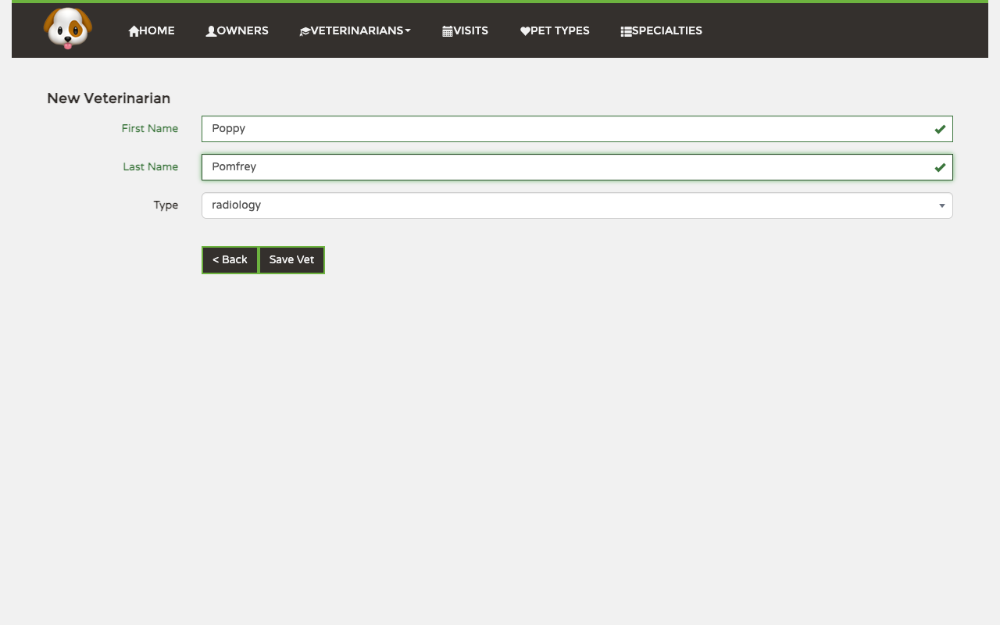

1. Click *Add Vet* below the list, or choose *Veterinarians* → *Add New* in the top menu.
2. Enter the vet's *First Name* and *Last Name*, and pick their specialty from the *Type* list.
3. Click *Save Vet* to save; you return to the list of vets. Click *< Back* to leave without saving.

### Editing a veterinarian

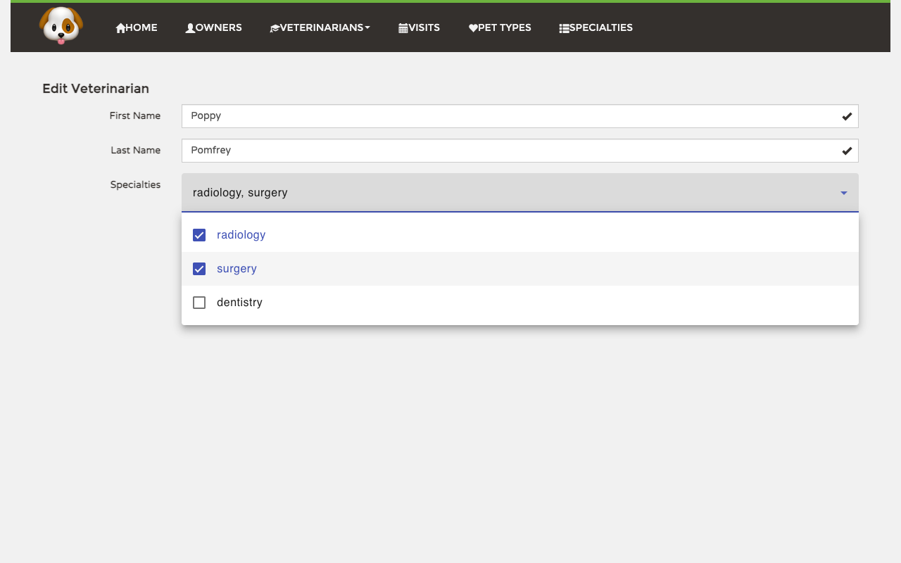

1. Click *Edit Vet* next to the vet you want to change.
2. The form opens with the vet's current name and specialties.
3. Click the *Specialties* box to open the list, then tick or untick specialties — a vet can have several.
4. Click *Save Vet* to save, or *< Back* to leave without saving.

---

## Specialties

Specialties are the areas of veterinary medicine the clinic offers (radiology, surgery, dentistry, ...). You assign them to vets in the [Veterinarians](#veterinarians) area.

### Viewing the list

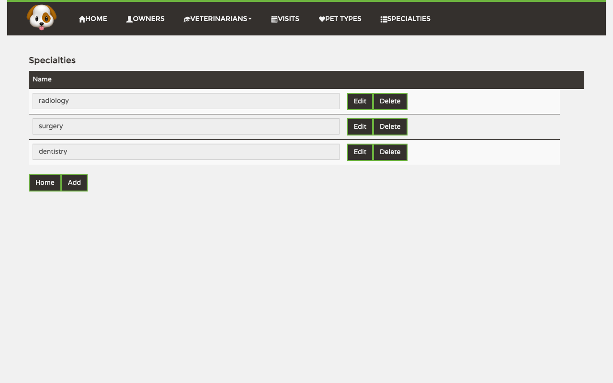

1. Click *Specialties* in the top menu.
2. Every specialty is listed with an *Edit* and a *Delete* button next to it.
3. *Home* takes you back to the Welcome screen; *Add* opens the form for a new specialty.

### Creating a new specialty

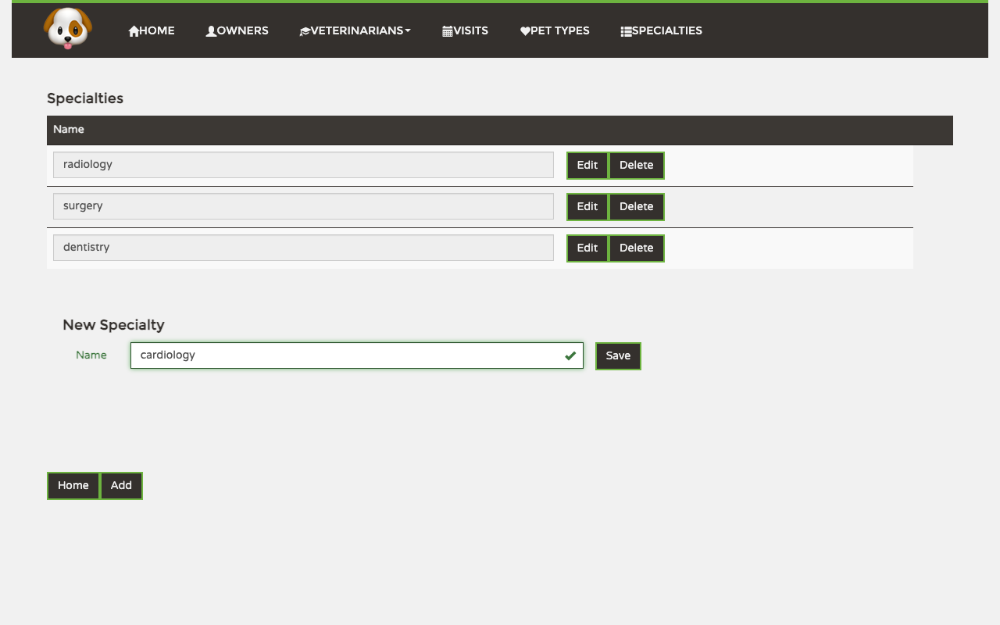

1. Click *Add* below the list. A *New Specialty* form appears under the table.
2. Type the name of the specialty.
3. Click *Save*. The specialty is added to the list and can now be assigned to vets.

### Editing a specialty

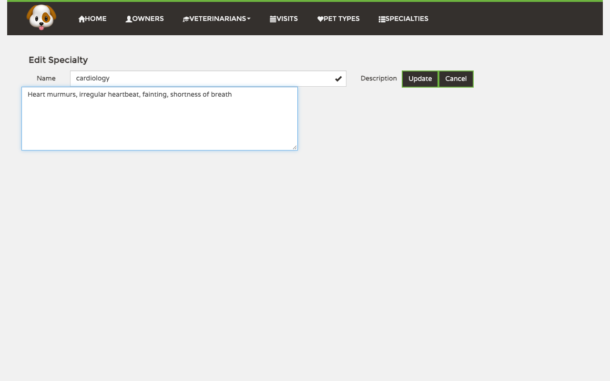

1. Click *Edit* next to the specialty you want to change.
2. The *Edit Specialty* form shows the name and a *Description*. Use the description to list the symptoms that point to this specialty — the clinic's support chatbot uses it to match an owner's question to the right kind of vet.
3. Click *Update* to save, or *Cancel* to return to the list without changes.
