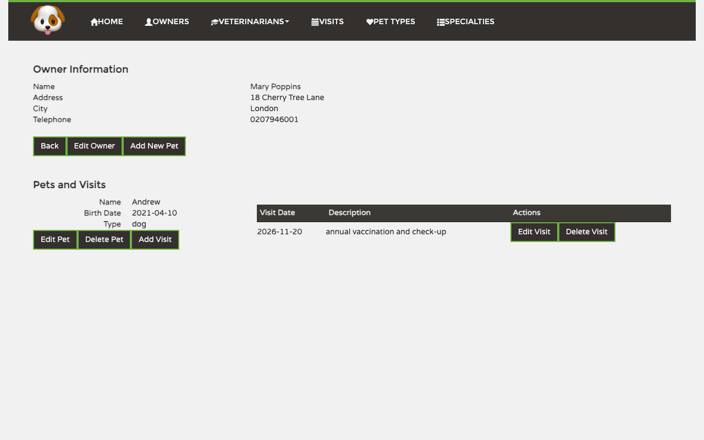

# PetClinic User Manual

PetClinic is a small veterinary practice management application. You can use it to keep records of pet owners, the pets in their care, the visits the pets make to the clinic, the kinds of animals the clinic treats, the veterinarians on staff, and the specialties those vets practice.

_This file is regenerated by the `/regen-user-manual` slash command. Do not edit by hand — your changes will be overwritten on the next regeneration._

## Contents

- [Getting around](#getting-around)
- [Welcome](#welcome)
- [Owners](#owners)
- [Pets](#pets)
- [Visits](#visits)
- [Pet Types](#pet-types)
- [Veterinarians](#veterinarians)
- [Specialties](#specialties)

---

## Getting around

The dark navigation bar at the top of every screen takes you anywhere in the application. *Home*, *Owners*, *Visits*, *Pet Types* and *Specialties* are plain links that open their screen straight away. *Veterinarians* is a dropdown menu: click it to choose between *All*, which lists every vet, and *Add New*, which opens the form for registering a vet. The dog logo on the left also takes you back to the start.

The screenshot above shows the *Veterinarians* menu opened, with its *All* and *Add New* entries.

---

## Welcome

The welcome screen is what you see when you first open PetClinic, and again whenever you click *Home*. It greets you and shows how many pet owners the clinic has registered. From here you start working through the navigation bar.

---

## Owners

The Owners area is the heart of the application. It holds the contact details of every pet owner, and each owner's record is where you look after their pets: to add a pet, record a visit, or correct a pet's details, you start from the owner's record (see [Pets](#pets) and [Visits](#visits)).

### Viewing the list

Click *Owners* in the navigation bar. The list shows each owner's name, address, city, telephone number and the names of their pets. Click an owner's name to open their record.

### Searching by last name

To find an owner quickly, type all or part of their last name in the *Last name* box at the top of the list and click *Find Owner*. The list narrows down to the matching owners. Clear the box and click *Find Owner* again to see everyone.

### Creating a new owner

1. At the bottom of the owners list, click *Add Owner*.
2. Fill in *First Name*, *Last Name*, *Address*, *City* and *Telephone*. All five are required. Names may contain only unaccented letters (no spaces, hyphens or accents), and the telephone digits only. A tick appears next to each field once it is filled in correctly.
3. Click *Add Owner* to save. The button stays greyed out until the form is complete. You return to the owners list, where the new owner now appears.

Click *Back* to leave without saving.

### Looking at an owner's record

The owner's record shows their contact details at the top, followed by *Pets and Visits*. That part lists each pet's name, birth date and type, and next to each pet, a table of its visits with the date and description.

From here you can:

- click *Edit Owner* to correct the owner's details;
- click *Add New Pet* to register another pet for this owner (see [Pets](#pets));
- click *Edit Pet* or *Delete Pet* under a pet;
- click *Add Visit* under a pet to record a visit (see [Visits](#visits));
- click *Edit Visit* or *Delete Visit* next to a visit;
- click *Back* to return to the owners list.

### Editing an owner

1. On the owner's record, click *Edit Owner*.
2. The form opens with the owner's current details already filled in. Change whatever needs correcting.
3. Click *Update Owner* to save. You return to the owner's record with the new details.

Click *Back* to discard your changes.

---

## Pets

Pets always belong to an owner, so you add and edit them from the owner's record (see [Owners](#owners)). A pet has a name, a birth date and a type, chosen from the list kept under [Pet Types](#pet-types).

### Adding a pet

1. Open the owner's record and click *Add New Pet*.
2. The *Owner* field is already filled in with the owner's name.
3. Type the pet's *Name*.
4. Enter the *Birth Date*, or click the calendar icon to pick it.
5. Choose the *Type* from the dropdown (cat, dog, hamster, …).
6. Click *Save Pet*. The button stays greyed out until every field is filled in.

You return to the owner's record, where the new pet appears under *Pets and Visits*.

Click *< Back* to leave without saving.

### Editing a pet

1. On the owner's record, click *Edit Pet* under the pet.
2. The form opens with the pet's name, birth date and type already filled in.
3. Make your changes and click *Update Pet* to save, or *< Back* to discard them.

To remove a pet, click *Delete Pet* under it on the owner's record.

---

## Visits

A visit records the date a pet came to the clinic, or is booked to come, and the reason. You add and edit visits from the owner's record (see [Owners](#owners)). The *Visits* screen in the navigation bar gives you an overview of every visit in the clinic.

### Viewing the list

Click *Visits* in the navigation bar. The list shows every visit, most recent first, with its date, description, the pet, and the pet's owner. Click the owner's name to open their record.

### Adding a visit

1. On the owner's record, click *Add Visit* under the pet.
2. The top of the screen shows the pet the visit is for. The bottom lists its *Previous Visits*.
3. Enter the *Date*, or click the calendar icon to pick it. The date must fall between the pet's birth date and one year from today.
4. Type a *Description* of the reason for the visit.
5. Click *Add Visit*. You return to the owner's record, where the visit appears next to the pet.

Click *Back* to leave without saving.

### Editing a visit

1. On the owner's record, click *Edit Visit* next to the visit.
2. The form opens with the visit's date and description already filled in, below the pet's details.
3. Make your changes and click *Update Visit* to save, or *Back* to discard them.

To cancel a visit, click *Delete Visit* next to it on the owner's record.

---

## Pet Types

Pet types are the kinds of animal the clinic treats (cat, dog, bird, …). They make up the *Type* dropdown you use when adding or editing a pet (see [Pets](#pets)).

### Viewing the list

Click *Pet Types* in the navigation bar. Each type is listed by name, with *Edit* and *Delete* buttons. Click *Home* at the bottom to return to the welcome screen.

### Creating a new pet type

1. At the bottom of the list, click *Add*.
2. A *New Pet Type* form opens below the list. Type the *Name*.
3. Click *Save*. The new type is added to the list and becomes available when you add a pet.

### Editing a pet type

1. Click *Edit* next to the type.
2. The *Edit Pet Type* form opens with the current name filled in.
3. Correct the name and click *Update* to save, or *Cancel* to discard the change.

To remove a pet type, click *Delete* next to it in the list.

---

## Veterinarians

This area lists the clinic's vets and the specialties each one practices. You reach it through the *Veterinarians* dropdown menu in the navigation bar (see [Getting around](#getting-around)).

### Viewing the list

Choose *Veterinarians › All*. Each vet is listed with their specialties, if they have any. Next to each vet there are *Edit Vet* and *Delete Vet* buttons. Click *Home* at the bottom to return to the welcome screen.

### Creating a new vet

1. Choose *Veterinarians › Add New*, or click *Add Vet* at the bottom of the vets list.
2. Fill in *First Name* and *Last Name*.
3. Choose one specialty from the *Type* dropdown, or leave it blank.
4. Click *Save Vet*. The button stays greyed out until both names are filled in. You return to the vets list, where the new vet now appears.

Click *< Back* to leave without saving.

### Editing a vet

1. In the vets list, click *Edit Vet* next to the vet.
2. The form opens with the vet's name and current specialties filled in.
3. To change the specialties, click the *Specialties* box. A list opens where you can tick as many specialties as apply, and untick the ones that no longer do.

   

4. Click *Save Vet* to save, or *< Back* to discard your changes.

To remove a vet, click *Delete Vet* next to them in the list.

---

## Specialties

Specialties are the areas of veterinary medicine the clinic's vets practice (radiology, surgery, dentistry, …). You assign them to vets on the vet's edit form (see [Veterinarians](#veterinarians)).

### Viewing the list

Click *Specialties* in the navigation bar. Each specialty is listed by name, with *Edit* and *Delete* buttons. Click *Home* at the bottom to return to the welcome screen.

### Creating a new specialty

1. At the bottom of the list, click *Add*.
2. A *New Specialty* form opens below the list. Type the *Name*.
3. Click *Save*. The specialty is added to the list and can now be given to vets.

### Editing a specialty

1. Click *Edit* next to the specialty.
2. The *Edit Specialty* form opens with the current name filled in.
3. Correct the name and click *Update* to save, or *Cancel* to discard the change.

To remove a specialty, click *Delete* next to it in the list.
