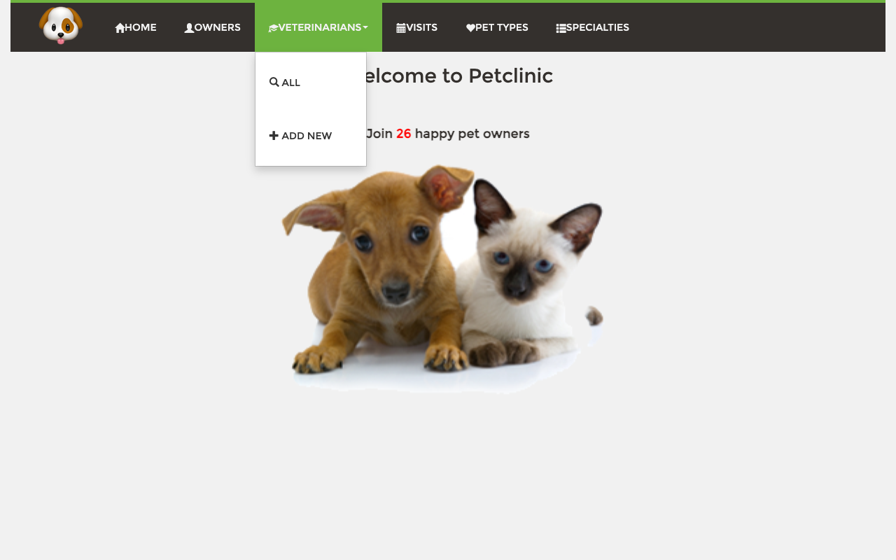
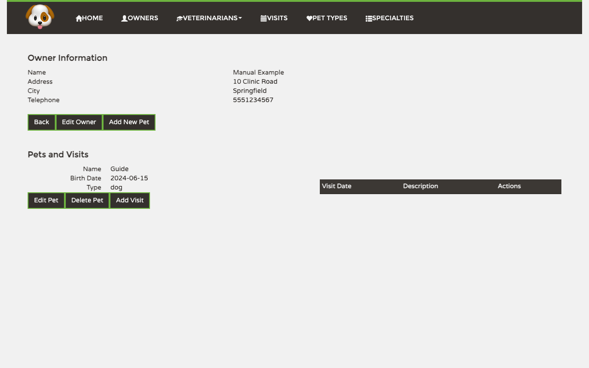
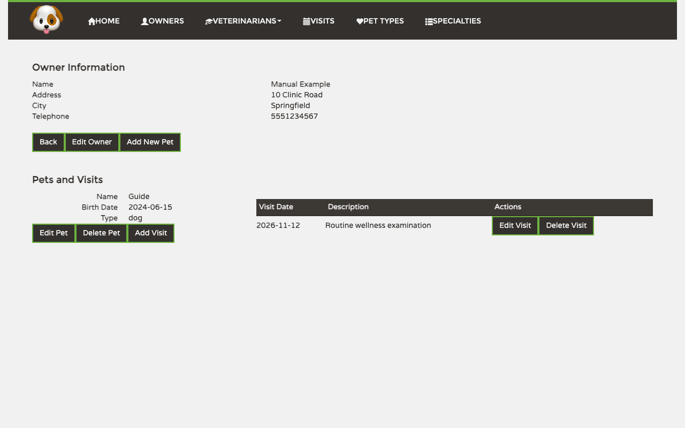

# PetClinic User Manual

PetClinic is a veterinary practice management application for keeping track of pet owners, their pets, clinic visits, veterinarians, pet types, and veterinary specialties.

_This file is regenerated by the `/regen-user-manual` slash command. Do not edit by hand — your changes will be overwritten on the next regeneration._

## Contents

- [Getting around](#getting-around)
- [Welcome](#welcome)
- [Owners](#owners)
- [Pets](#pets)
- [Visits](#visits)
- [Pet Types](#pet-types)
- [Veterinarians](#veterinarians)
- [Specialties](#specialties)

---

## Getting around

Use the navigation bar at the top of every screen to move through PetClinic. *Home* opens the welcome screen, *Owners*, *Visits*, *Pet Types*, and *Specialties* open their respective lists, and the *Veterinarians* menu provides separate links for viewing all veterinarians or adding a new one.

The open *Veterinarians* menu shows the *All* and *Add New* choices.

---

## Welcome

The welcome screen is the starting point for the application and shows the current number of registered pet owners.

---

## Owners

The Owners area stores contact details for pet owners and provides access to each owner's pets and visits. Start here when you need to register a pet or book a visit.

### Viewing the list

Open *Owners* from the navigation bar to see each owner's name, address, city, telephone number, and pets. Enter a surname in *Last name* and click *Find Owner* to narrow the list. Click an owner's name to open the full record, or click *Add Owner* to register someone new.

### Creating a new owner

Click *Add Owner*, then enter the owner's first name, last name, address, city, and telephone number. Click *Add Owner* to save the record and return to the list, or *Back* to leave without saving.

### Looking at an owner's record

The owner record shows contact information followed by the owner's pets and their visits. Click *Edit Owner* to change contact details, *Add New Pet* to register a pet for this owner, or *Back* to return to the owners list.

### Editing an owner

Click *Edit Owner* on the owner record. Update the pre-filled fields and click *Update Owner* to save, or click *Back* to discard your changes.

---

## Pets

Pets belong to an owner and are managed from that owner's record. Each pet record includes its name, birth date, type, and visit history.

### Viewing a pet's record

Open an owner and look under *Pets and Visits*. Each pet entry shows its name, birth date, type, and previous visits. Use *Edit Pet* to change the pet, *Delete Pet* to remove it, or *Add Visit* to book an appointment.

### Adding a pet

Open the owner who cares for the pet and click *Add New Pet*. Enter the pet's name and birth date, choose its type, and click *Save Pet*. The owner is selected automatically. Click *Back* to return without saving.

### Editing a pet

Click *Edit Pet* beside the pet on its owner's record. Change the pre-filled name, birth date, or type, then click *Update Pet* to save. Click *Back* to discard the changes.

---

## Visits

The Visits area provides a clinic-wide appointment history. New visits are booked for a specific pet from the pet's owner record.

### Viewing the list

Open *Visits* from the navigation bar to see visits with their dates, descriptions, pets, and owners. Click an owner's name to open the related owner record and review the pet's full visit history.

### Adding a visit

Open an owner, find the relevant pet, and click *Add Visit*. Confirm the pet and owner shown at the top, enter the visit date and description, and click *Add Visit* to save. Previous visits are displayed below the form for reference.

### Looking at a visit

Saved visits appear beside the pet on the owner record. Review the date and description, then use *Edit Visit* to make a correction or *Delete Visit* to remove the entry.

### Editing a visit

Click *Edit Visit* beside a saved visit. Update the pre-filled date or description and click *Update Visit* to save. Click *Back* to leave the visit unchanged.

---

## Pet Types

Pet Types maintains the categories available when staff register or edit pets, such as cat, dog, bird, or horse.

### Viewing the list

Open *Pet Types* from the navigation bar to view all available categories. Click *Edit* beside a type to rename it, *Delete* to remove it, or *Add* to open the new-type form.

### Creating a new pet type

Click *Add*, enter the new type's name in the form below the list, and click *Save*. The new category then becomes available when adding or editing pets.

### Editing a pet type

Click *Edit* beside a pet type, change the pre-filled name, and click *Update* to save. Click *Cancel* to return to the list without changing it.

---

## Veterinarians

The Veterinarians area lists clinic staff and the specialties assigned to each person.

### Viewing the list

Open *Veterinarians* and choose *All* to see each veterinarian and their specialties. Click *Edit Vet* to update a staff member, *Delete Vet* to remove one, or *Add Vet* to register a new veterinarian.

### Creating a new veterinarian

Choose *Add New* from the *Veterinarians* menu or click *Add Vet* on the list. Enter the first and last names, choose a specialty, and click *Save Vet*. Click *Back* to leave without saving.

### Editing a veterinarian

Click *Edit Vet* beside a veterinarian. Update the pre-filled name or specialty selections and click *Save Vet*. Click *Back* to discard the changes.

---

## Specialties

Specialties maintains the areas of veterinary expertise that can be assigned to veterinarians.

### Viewing the list

Open *Specialties* from the navigation bar to see all available specialties. Click *Edit* to update one, *Delete* to remove one, or *Add* to display the new-specialty form.

### Creating a new specialty

Click *Add*, enter the specialty name, and click *Save*. The new specialty becomes available when adding or editing a veterinarian.

### Editing a specialty

Click *Edit* beside a specialty. Change its name or update the description used to identify relevant concerns, then click *Update* to save. Click *Cancel* to return without changing it.

---
