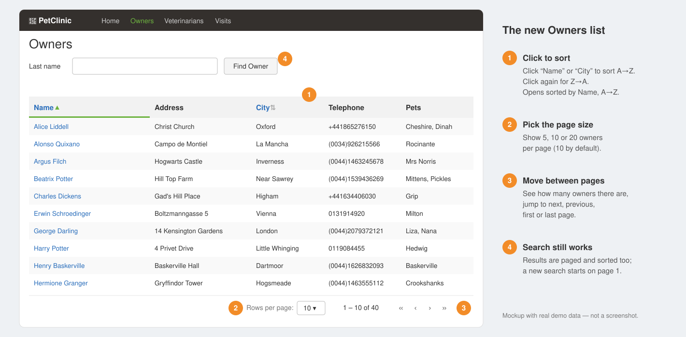

# Proposal: A faster, easier Owners list

## Why

Today the Owners screen loads **every owner at once**. That is fine with a few dozen people, but the clinic expects about **100,000 new owners every year**. Within months, the screen would be slow to open and impossible to scan by eye.

Issue #25 asks for an Owners list that you can **page through** and **sort**.

**See it in action:** the list opens sorted by name, a click on "City" re-sorts it, and "next page" shows owners 11–20.

## What Changes

**Pages instead of one endless list**
- The Owners list shows **10 owners per page** by default.
- The user can switch to **5, 10 or 20** owners per page.
- The screen shows how many owners there are in total, and lets the user move to the next, previous, first or last page.

**Sorting**
- The user can sort the list **by Name** or **by City**, by clicking the column title. Clicking again reverses the order (A→Z, then Z→A).
- When the screen opens, owners are sorted **by Name, A→Z**.
- Name sorting goes by **first name, then last name**, as names are shown on screen.
- Address, Telephone and Pets cannot be sorted, because these values have no meaningful alphabetical order (phone numbers come in mixed formats, for example).
- Names with accents sort where people expect them: **Ștefan** sits among the S names, not after Z.
- Owners with the same name always show up in the same order, so nobody appears twice or goes missing when you move between pages.

**Search still works**
- The "Find Owner" search by last name stays. The results are paged and sortable too, and a new search always starts from the first page.

**The screen remembers where you were**
- If you open an owner and then press **Back**, you return to the same page with the same sorting.
- Refreshing the browser keeps the page you were on. You can also copy the address and send it to a colleague, who sees the same page.

## Capabilities

### New Capabilities
- `owner-listing`: browsing the list of owners: searching by last name, moving between pages and sorting.

### Modified Capabilities
<!-- none -->

## Impact

- **Who notices**: everyone who uses the Owners screen.
- **What stays the same**: the owner details page, adding and editing owners, visits, and the chatbot.
- **Out of scope**: sorting by address, telephone or pets; any change to other lists (vets, visits).
- The technical consequences (API contract, database, affected code) are in [design.md](design.md).
