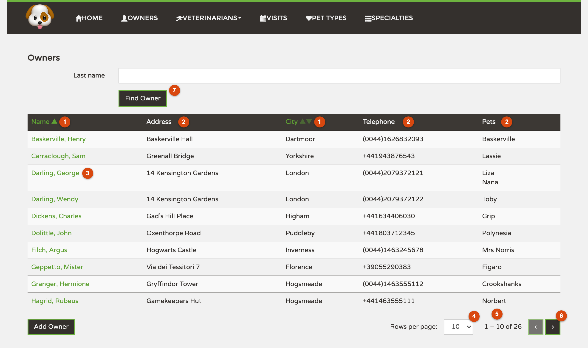

# Proposal: an Owners list that stays fast with 50,000 owners

## Why

Today the Owners screen shows every owner in the clinic at once, in one long list. That works with
the 26 owners we have now, but we expect around **50,000 owners within a year**. At that size the
screen would take a long time to open and would be impossible to scroll through.

Issue [#25](https://github.com/victorrentea/petclinic/issues/25) asks for the list to be split into
pages and to be sortable. The details were agreed in a Q&A session, recorded in
[`QA.md`](../../../QA.md).

## What It Will Look Like

This is the real application with the proposed changes drawn in; the rows are the clinic's demo data.

1. Click **Name** or **City** to sort A → Z; click again for Z → A.
2. **Address**, **Telephone** and **Pets** can't be sorted (see below why).
3. Names show the last name first, so you can see the list really is alphabetical.
4. Choose 5, 10 or 20 owners per page.
5. The total number of owners is always shown.
6. Previous / next page.
7. A search by last name starts again from page 1 and keeps the chosen order.

Not visible in the picture: the browser's address remembers the page and the order, so Back, refresh,
or a link sent to a colleague opens the same page.

## What Changes

**Pages instead of one long list**
- The Owners screen shows one page at a time: 5, 10 or 20 owners, as the user chooses. 10 by default.
- It always says how many owners there are in total, e.g. "1 – 10 of 26".
- The user moves between pages with next / previous buttons.

**Sorting**
- The user can sort the list by **Name** or by **City**, from A to Z or from Z to A.
- By default the list is sorted by name, A to Z.
- Names with accents sort where people expect them: "Śliwiński" sits next to "Silver", not at the
  end of the list after every name starting with Z.

**What is not sortable, and why**
The issue asked for sorting by *any* column. We looked at the real data and propose to leave three
columns unsortable, because sorting them would produce an order that means nothing to the reader:
- **Address**: written freely, some start with a house number ("12 Boltzmanngasse"), others with a
  street type ("Calle de Alcalá 42"), so A–Z would just group the numbers first.
- **Telephone**: written in four different styles ("+48…", "(0044)…", "0034…", plain digits), so the
  order would follow the style, not the country or the number.
- **Pets**: every owner has one or two pets, so there is nothing useful to order by.

**Names shown last name first**
Because the list sorts by last name, names are shown as "McCallister, Kevin" instead of
"Kevin McCallister". Otherwise the list would look shuffled.

**The screen remembers where you were**
- After opening an owner's details and going back, the user lands on the same page, in the same order.
- The address of a page can be copied and sent to a colleague, who will see exactly the same page.

**Searching by last name still works**
- Searching starts again from the first page of results and keeps the chosen sort order.
- When nothing matches, the screen says so.

**Not part of this change**
- Searching regardless of upper/lower case ("potter" finding "Potter").
- Cleaning up telephone numbers into one format (that would make sorting by phone possible later).

## Capabilities

### New Capabilities

- `owner-list`: how clinic staff browse the list of owners — searching by last name, moving between
  pages, and choosing the order.

### Modified Capabilities

_None._

## Impact

- **Clinic staff** get a faster Owners screen that stays usable as the clinic grows. They will notice
  names written last name first and the page controls under the list.
- **No other screen changes.** The chatbot, visit booking and text-message notifications are not
  affected.
- **The issue's request is narrowed** to sorting by Name and City (see above); the product owner
  should confirm this is acceptable.
- Engineering details — what changes in the code, the database and the tests — are in
  [`design.md`](design.md).
