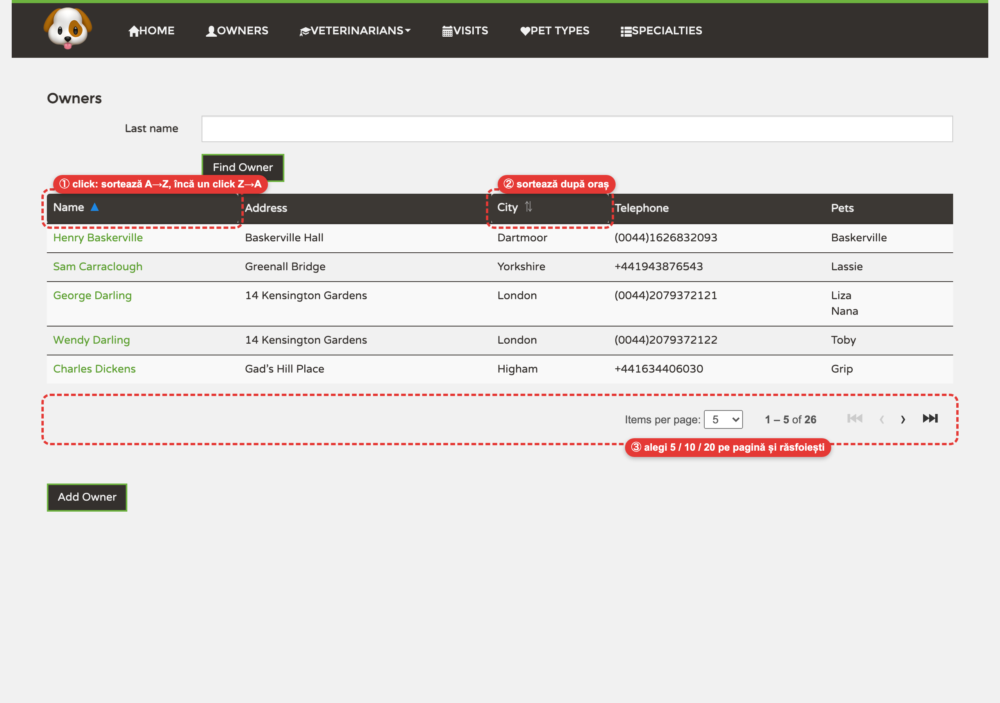

# Proposal

## Why

Azi, când deschizi lista de stăpâni de animale, aplicația îi aduce pe **toți** odată, ca și cum ai
scoate din dulap toate dosarele clinicii ca să cauți unul. Cu 26 de stăpâni merge. Peste un an ne
așteptăm la vreo **100.000**, iar atunci ecranul s-ar încărca greu sau deloc.

Soluția e cea dintr-o carte de telefon: vezi câte o pagină și poți răsfoi.

## What Changes

Așa ar arăta ecranul (schiță desenată peste ecranul de azi, [cum e acum](owners-today.png)):

- **Lista se vede pe pagini.** Alegi câți stăpâni vezi pe pagină: 5, 10 sau 20. Dacă nu alegi, vezi 10.
  Jos scrie câți sunt în total și poți merge la pagina următoare sau la cea dinainte.
- **Lista se poate ordona după două coloane:**
  - **Nume**: alfabetic după numele de familie, iar la nume egale după prenume (Beatrix Potter înaintea
    lui Harry Potter);
  - **Oraș**: alfabetic după oraș.
  Un click pe titlul coloanei ordonează de la A la Z, al doilea click de la Z la A.
- **Celelalte coloane nu se ordonează, intenționat:**
  - **Telefon**: numerele sunt scrise în feluri diferite (cu +, cu paranteze, cu 00 în față), deci
    ordinea ar ieși fără sens;
  - **Adresă**: unele încep cu numărul străzii, altele cu numele ei;
  - **Animale**: un stăpân are mai multe animale, deci nu e clar după care l-am ordona.
- **Căutarea după numele de familie rămâne** și merge împreună cu paginile: cauți „Potter” și vezi doar
  familia Potter, tot pe pagini. O căutare nouă te duce mereu la prima pagină.
- **Aplicația ține minte unde erai.** Dacă ești pe pagina 2, ordonat după oraș, deschizi un stăpân și
  apeși „Înapoi”, te întorci tot pe pagina 2, ordonat după oraș.
- **Ce NU intră acum:** corectarea numerelor de telefon și a adreselor scrise inconsecvent, căutarea
  după altceva decât numele de familie și un set de 100.000 de stăpâni pentru demo. Demo-ul se face
  pe cei 26 de stăpâni existenți.

## Capabilities

### New Capabilities
- `owner-listing`: cum vede clinica lista stăpânilor: căutare după nume, pagini, ordonare.

### Modified Capabilities
<!-- none -->

## Impact

- Se schimbă ecranul cu lista de stăpâni și felul în care serverul îi trimite: câte o pagină, nu toți odată.
- Nu se schimbă nimic din datele existente, nici restul ecranelor.
- Partea de server și ecranul se lansează împreună, ca să se înțeleagă între ele. Detaliile tehnice
  sunt în `design.md`.
