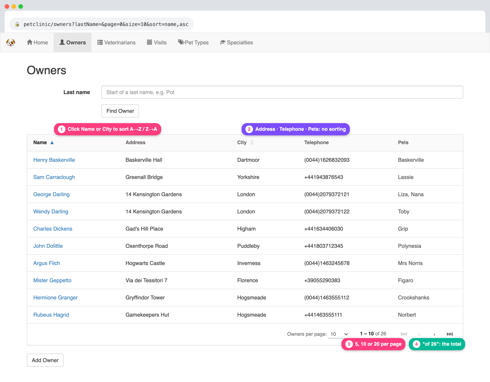

# Proposal

## Why

Today the Owners screen shows **every owner in the clinic on one long page**, in no particular
order. With the 26 owners we have now that's fine. But we expect around **100,000 owners by the
end of 2027**. At that size the screen would take longer and longer to open, and finding one
owner by scrolling would be hopeless.

So the Owners screen will show owners **a few at a time, in a chosen order** (issue #25). The
important part: the clinic's system sends the screen only the owners it is about to show. It
never sends all 100,000 and lets the screen hide most of them. That's what keeps the screen fast
as the clinic grows.

The questions and answers behind this proposal are in [`Q&A.md`](../../../Q&A.md). Two were
decided by the product owner: the paging happens in the system, not in the screen, and only Name
and City are sortable. The rest are recommendations to confirm in the Three Amigos meeting.

## What Changes

This is roughly how the new Owners screen will look, with the clinic's real owners:

**Pages of owners**
- The Owners screen shows one page of owners at a time: **5, 10 or 20 per page**, 10 unless the
  user picks otherwise.
- Below the list: which owners are shown and how many there are in total (e.g. "11 – 20 of 26"),
  with buttons for the next, previous, first and last page.

**Sorting**
- The user can sort by **Name** or by **City**, A→Z or Z→A, by clicking the column title.
- *Name* means **last name first**: **Wendy Darling comes before Harry Potter**, because D comes
  before P, even though H comes before W. Only owners sharing a last name are then ordered by
  first name: George Darling before Wendy Darling.
- *City* sorts by city, and owners in the same city by name.
- If the user chooses nothing, the list is sorted by Name A→Z.
- **Address, Telephone and Pets cannot be sorted.** We looked at the real data:
  - addresses start sometimes with a house number and sometimes with a street name;
  - phone numbers are written in several different formats (+44…, (0044)…, 0044…);
  - an owner has several pets.

  Sorting any of these would give an order that means nothing to the user. The issue asked for
  "any column"; this is the one place where we deliberately do less.
- Names with accents sort where a reader expects them: **Śliwiński sits with the S's**, not after
  Wensleydale as it would today.
- When several owners share a name or a city, they always appear in the same order. An owner
  never shows up on two pages, and never goes missing between pages.

**Searching**
- Searching by the start of a last name works exactly as today, including the difference between
  upper and lower case ("Pot" finds the Potters, "pot" doesn't). The results are then paged and
  sorted the same way.
- A new search, or choosing a different sort, goes back to the first page.
- When nothing matches, the screen says so clearly: "No owners with last name starting with
  'Zzzz'". Today that message never appears.

**Keeping your place**
- The page, the sort and the search are kept in the screen's web address. Refreshing the browser,
  pressing Back, or sending the link to a colleague opens exactly the same page.

**Not part of this change**
- Searching by city or by phone number.
- Cleaning up the phone numbers into one format.
- Sorting by number of pets.
- Searching regardless of upper/lower case.

Each of these can become its own request if the business wants it.

## Capabilities

### New Capabilities
- `owner-list`: browsing the list of owners, a page at a time, sorted, and optionally narrowed by
  the start of a last name.

### Modified Capabilities
<!-- none -->

## Impact

- **Clinic staff**: the Owners screen looks different. A paged, sortable table replaces the
  single long list. Opening an owner, adding an owner and searching by last name work as before.
- **Other systems reading the owner list**: the clinic's own screens are adapted in the same
  release. We know of no outside system that reads this list. If one exists, it must be adapted
  at the same time, because the list's format changes.
- **Data**: no owner, pet or visit is changed or lost. The database only gets the extra lookup
  structures it needs to sort and page quickly.
- **Release**: the screen and the system behind it must be released together.

How it's built is in [`design.md`](design.md), and the exact expected behaviour is in
[`specs/owner-list/spec.md`](specs/owner-list/spec.md).
